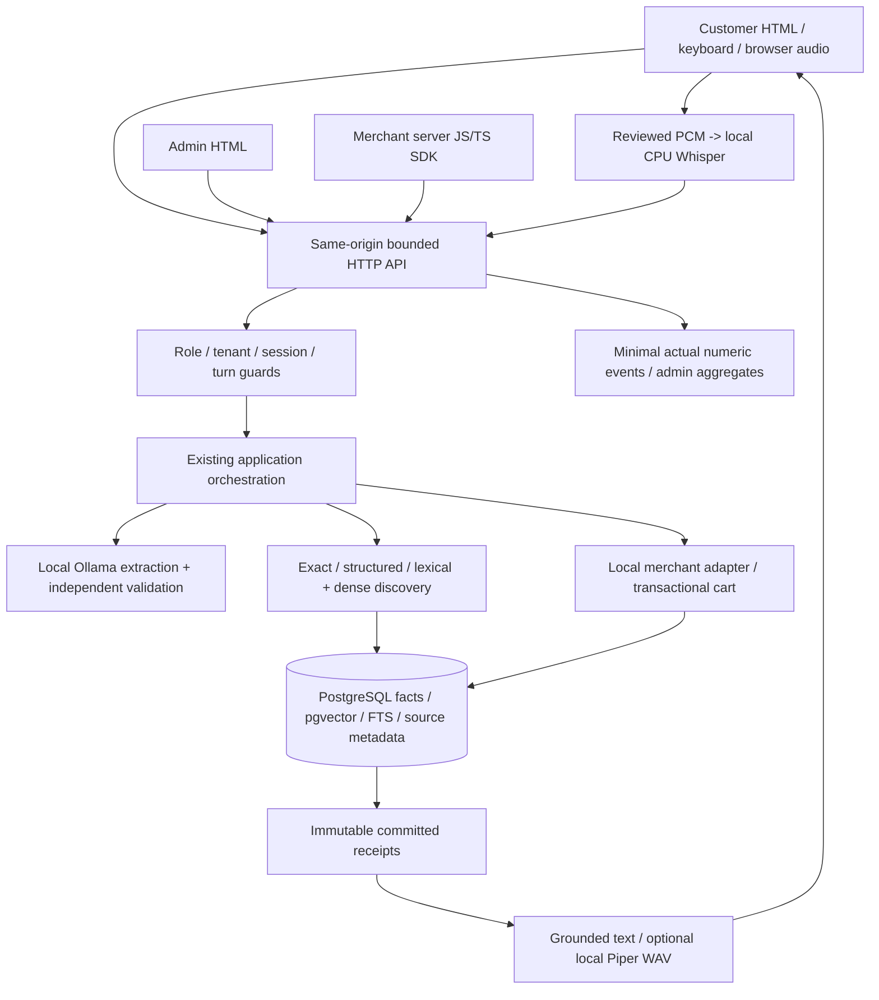

# VoiceCart

**Local, accessible product discovery with deterministic, receipt-verified cart actions.**

VoiceCart helps people search with speech or text, inspect grounded product information and control every local cart change. It is designed with blind and low-vision users in mind: important interactions have keyboard/text alternatives, clear status announcements, explicit transcript review and recovery controls. The prototype preserves an existing Python/PostgreSQL architecture and adds real customer/admin interfaces, sourced historical metadata, a merchant adapter/SDK and executable testing evidence.

This is version **0.2.0**, an engineering demonstration with explicit release gates. It is not a live Amazon shop, operated managed cloud service, certified accessible product or sub-1.5-second voice system. Checkout, payments, stock reservation, order tracking and unsupported external merchant writes are outside the implemented scope.

## Additive validation and professor practical — 3 November 2026

S16–S21 continue the existing architecture. Fresh verification, safety/latency comparison, HTTP/deployment fixes, controlled voice/accessibility failures and transaction/concurrency evidence are summarized in [ADDITIVE_EXECUTION_REPORT.md](docs/ADDITIVE_EXECUTION_REPORT.md). Start an examination with the self-contained [professor practical pack](docs/PROFESSOR_PRACTICAL_PACK.md) and [quick checklist](docs/PROFESSOR_DEMO_CHECKLIST.md). The [human involvement register](docs/HUMAN_INVOLVEMENT_REQUIRED.md) turns each pending device/user/credential/deployment/legal decision into an executable procedure; the [release checklist](docs/RELEASE_READINESS_CHECKLIST.md) is explicit about unaccepted gates.

New evidence is append-only under timestamped/dedicated run directories; November2 JSON remains historical. Current authored32-case NLU comparison met26 expectations on4B and21 on0.6B; neither is general accuracy. The faster smaller model was not promoted. [NLU methodology/results](docs/NLU_EVALUATION_20261103.md), [route authorization matrix](docs/ROUTE_AUTHORIZATION_MATRIX.md), [voice/accessibility outcomes](docs/VOICE_ACCESSIBILITY_20261103.md), [transactions/load](docs/TRANSACTION_AND_SCALE_20261103.md), [external integration specification](docs/MERCHANT_INTEGRATION_SPEC.md), [licensing decisions](docs/LICENSING_DECISIONS.md). No production-ready label is assigned.

## Problem, users and objectives

Conventional shopping can require scanning dense product grids, interpreting incomplete specifications and navigating changing cart controls. A voice interface alone does not solve those problems: recognition can lose a price boundary or negation, a cheap accessory may be irrelevant, missing inventory may be mistaken for availability, and a retry may add twice.

VoiceCart therefore separates language interpretation from authority. Models propose an intent; validated Python and the backend own product facts, hard constraints, integer money, ranking boundaries, writes and outcomes. The goal is useful, understandable discovery and predictable search-to-cart interaction, including ambiguity, cancellation and failure—not merely a spoken fluent answer.

Target users include customers using speech, keyboard or assistive technology; administrators managing trustworthy source data; and developers/merchant operators integrating a local or future hosted deployment. Representative blind/low-vision user acceptance is still required; automated checks are not a usability study.

## Capability and verification status

| Capability | Status | Evidence / practical boundary |
|---|---|---|
| Domain, exact/structured eligibility, strict/inclusive integer money | Implemented and verified | Unit/oracle/real SQL boundary tests |
| PostgreSQL/pgvector, checksummed migrations, atomic full-snapshot publication | Implemented and verified | Real isolated service, concurrency/rollback/snapshot/restore and fresh-wheel tests |
| Lexical + exact dense discovery and separate known-price role | Implemented and verified as mechanisms | Actual MiniLM/real metadata query; human relevance/weights remain uncalibrated |
| Local schema-constrained NLU + independent validation | Implemented but not fully verified | Fresh32-case authored bank26/32 on4B; quantity and other safe rejections remain |
| Persistent sessions, idempotent cart/immutable receipts, quantity/remove/recovery | Implemented and verified | Real PostgreSQL/HTTP/Node concurrency/replay/receipt tests |
| Customer desktop/mobile browser UI | Implemented and verified in tested Chromium states | Search/details/cart/reload, keyboard/dialog/mobile layout and axe checks |
| Local Whisper/Piper and browser review/cancel flow | Implemented but not fully verified | Actual file/HTTP inference; scripted browser capture race tests; physical device/user acceptance pending |
| Admin catalogue/variants/import/history/provenance/actual analytics | Implemented and verified | Real API/SQL + browser edit/auth tests; JSON supported, CSV not implemented |
| Real historical catalogue | Implemented and verified | 300 official source rows,298 admitted,169 known historical USD prices,zero known current stock |
| Shared local merchant adapter + server-side JS/TS SDK | Implemented and verified | Actual local SDK path and two-database tenant isolation; external platforms unsupported |
| Compose deployment | Implemented but not fully verified | Static YAML/digests/security/dependency configuration; Docker runtime unavailable here |
| Managed hosting, Shopify/WooCommerce/Magento adapters | Planned | Architecture/contract documented; no live service or platform support claimed |
| Physical audible latency, human accessibility, other language/platform acceptance | Blocked / Not Run | Requires approved devices/users/profile; 1.5s goal remains unachieved/unverified |
| Dataset/voice/project commercial distribution | Blocked on owner decision/rights verification | Exact inventory and unresolved terms in LICENSING.md |

[HANDOFF.md](HANDOFF.md) is the final operational/status report. [IMPLEMENTATION_PLAN.md](IMPLEMENTATION_PLAN.md) preserves sequential sprint acceptance and evidence. Historical sprint observations are not substituted for continued execution.

## Customer journey

1. Open the customer page, choose a currency and type a product/category/purpose or explicitly start voice input.
2. End the microphone turn. Review/correct/discard its final transcript before submission. Recording itself never adds a product.
3. Browse results, inspect title/brand/known variants/attributes/provenance and understand price freshness and availability. External images load only after an opt-in control.
4. Use explicit price/boundary/brand controls. Text price instructions are rejected if those controls disagree; they are not silently dropped. Optional Shopping assistant mode uses the configured local NLU for a full reviewed instruction.
5. Keep overall relevance, the lowest known matching price and other alternatives distinct. Historical metadata cannot establish a current global minimum or authorize a cart add.
6. For a current verified offer, explicitly add the selected variant. The backend rechecks it and confirms only a committed authoritative receipt. Quantity changes/removal have their own idempotent receipts.
7. Use cart/operation records after an interruption; retry the original operation ID. Repeat replays without another add. Stop fences processing/audio and does not undo a committed write.

The historical demo intentionally has disabled add buttons: unknown stock is not fabricated to make a cart screenshot work. Genuine current-offer cart behavior is verified with isolated test fixtures; operational merchants must supply real current facts. Natural-language price interpretation is presently the existing English/INR profile. Historical USD discovery uses explicit currency/price controls; USD NLU is not falsely advertised.

Shortcuts: Alt+S starts/ends recording, Alt+R repeats, Alt+C opens cart, Alt+H opens help and Escape stops/closes the active interaction. They are discoverable and can be disabled in Help. Browser/assistive-technology conflicts require user acceptance; keyboard controls remain available without shortcuts.

## Administrator journey

Sign in at `/admin` with the privately provisioned merchant token. Inspect actual records/provenance, edit or create products and their explicit variants, or deactivate a selected product with confirmation. Edits publish a validated full snapshot against the revision loaded; concurrent changes require a reload. Import/export uses JSON, with indexed validation/duplicate feedback and real publication history. Historical source facts are not automatically promoted to current offers.

The dashboard reports actual catalogue/price/attribute coverage, environment-scoped event outcomes/durations and committed local adds. It does not generate fake activity, retain raw popular queries or invent checkout conversion. Health distinguishes actual DB/schema/publication/model identity from unmeasured audio devices. Test databases/events never become real merchant analytics.

## System architecture



One PostgreSQL transaction/snapshot boundary was selected for catalogue publication, relational eligibility, sessions/cart and receipts. This reduces cross-store coordination compared with SQLite plus a separate vector service. It is not a measured database speed/relevance win. Exact vector scoring is retained at this scale; ANN/reranking require a demonstrated need and recall/quality evaluation. [ARCHITECTURE.md](docs/ARCHITECTURE.md), [the continuation audit](docs/ARCHITECTURE_AUDIT.md) and [ADRs](docs/decisions/0001-reference-storage.md) explain alternatives, limitations and migration decisions.

### Components and repository layout

| Module/group | Actual responsibility |
|---|---|
| domain.py, catalogue.py, ranking.py | Typed contracts, three-valued eligibility, full-source minimum, qualified permutation boundary |
| ingestion.py, dataset.py, embeddings.py | Validated source snapshots, historical normalization/provenance, pinned encoder generation |
| database.py, migrations/ | Parameterized SQL, checksums/readiness, atomic CAS publication, consistent snapshots |
| search.py, browse.py | Strict commerce routes plus separately labelled historical read-only lexical/exact-dense discovery |
| nlu.py, local_http.py | Bounded local extraction, literal-constrained schema and independent semantic/action checks |
| sessions.py, application.py | Session/turn/list identity, finalized-once processing, clarification/cancel/repeat and orchestration |
| cart.py, cart_management.py | Guarded add, target quantity/remove, idempotency, immutable receipt and uncertain-outcome reconciliation |
| audio.py, voice.py | Native half-duplex contracts, verified Whisper/Piper files, device/drain/cancel and truthful delivery status |
| server.py, web_api.py, admin.py, http_security.py | HTTP/body/worker/origin/rate boundaries, customer/admin roles, signed capabilities and actual endpoints |
| merchant.py, merchant_api.py, sdk/ | Common adapter contract, actual local path and server-side JS with TS declarations |
| telemetry.py, events.py | Context-isolated numeric stage timing and minimal real environment-scoped analytics |
| voicecart/web/ | Packaged semantic customer/admin HTML, CSS and dependency-free browser JS |
| tests/, scripts/, docs/ | Guarded fixtures/contracts/browser/SDK drivers, verification/analysis/load tools and source-linked evidence |

No frontend framework, cloud inference dependency or second vector database was added merely to match a diagram. Frontend static assets and SQL migrations are included in the wheel. Node is development verification/SDK tooling, not required by the Python web server.

## Voice and request flow

Browser capture is explicit, bounded to30 seconds and half duplex with playback. PCM is resampled to mono16kHz signed16-bit, sent to configured local Whisper and returned for review; no partial/final transcript is allowed to mutate the cart directly. The native CLI uses its existing sounddevice/controller adapters. Models are provisioned separately and verified by SHA-256 or local runtime manifest digest; startup never downloads them.

Async final requests register a server turn first. A final carries that ID; cancellation/supersession cannot let a delayed final restart a new add. ASR cancellation checks its event immediately as well as session state, closing the race before DB cancellation completes. Text responses and explicit error status remain available when model, mic, TTS or playback fails. Late audio/transcripts and incomplete lists are fenced. Ordinal references require an explicit acknowledgement of the complete current list.

Piper synthesis produces actual local audio; browser playback completion/native PortAudio drain is not proof that a user heard it. No browser cloud speech API is used. Headless microphone capture on this host returned NotSupportedError; the browser capture/review race test is explicitly scripted, while actual ASR/Piper file/HTTP inference is separate evidence. Human/device/noise/screen-reader acceptance remains open.

## What the LLM may and may not decide

Ollama receives bounded request/vocabulary data and an exact schema. Literal evidence, canonical attributes, numbers, operators, currency, quantity, negation, references and action permission are independently checked. Malformed/truncated/duplicate/nonfinite output, wrong model digest or remote inference metadata fails safely. No keyword-based general NLU fallback pretends to replace the model.

The model does not own product facts, hard eligibility, money arithmetic, catalogue coverage, selected database IDs, cart state or outcomes. Structured/exact eligible adds and complete structured cheapest instructions can be dispatched under deterministic guards; subjective/ambiguous discovery asks for a current choice. The actual frozen holdout met11 of12 expectations; a two-item request was safely rejected. This is a release-quality gap, not hidden as a schema-only success or generalized accuracy.

## Retrieval, ranking and cheapest semantics

Three core routes remain separate: exact product/SKU/variant/model lookup, complete structured eligibility/price ordering, and lexical/dense discovery. Hard constraints precede ranking. A semantic top-K cannot prove a source-wide minimum. Unknown potentially matching facts, missing variants, stale prices and incomplete coverage block stronger claims.

Current-offer core ranking uses the existing explicitly experimental literal-coverage/title/semantic/price policy. It has not been tuned to owner human judgments. Historical browsing orders lexical rank, exact semantic score and historical-price ties without inventing learned weights. Dense-only suggestions never become the global cheapest role; the separate lowest-known role is scoped to evaluated literal matches and explicit currency. Stronger subjective relevance remains unverified; no system can honestly guarantee the human-best product for every possible query from these observations.

Model/digest/dimensions/query/document prefixes/serializer identify an embedding generation. Different spaces are never mixed. The opt-in `metadata-prefix-256utf8bytes-v1` profile bounds only derived encoder input, preserving the complete authoritative source and FTS document. It is lossy feature preprocessing and requires explicit matching reimport/re-embedding. The default profile remains unchanged. [ADR-002](docs/decisions/0002-historical-discovery.md) and actual real-data semantic evidence describe the trade-off.

## Database, source and cart design

Six checksummed SQL migrations define products/variants/search features/source coverage, expiring sessions/lists, commands/cart/immutable receipts, accepted finals, provenance/import history, target-quantity receipts and actual events. Readiness verifies current packaged migration hashes and pgvector; it never silently migrates or seeds data. Publication prepares model features before write locks, compares `previous_revision`, then commits facts/index/provenance/history atomically. Search reads a consistent snapshot.

Money is nonnegative integer minor units with explicit uppercase currency, maximum2^63−1. Booleans/floats are invalid money; under is LT and at-most LTE. Missing facts remain unknown. Source expiry changes display/eligibility to unverified rather than showing old availability as current.

Cart state is session scoped. An add persists its operation identity, locks/revalidates current facts including aggregate quantity/stock/observed revision and price, atomically updates the cart and receipt, then verifies the committed receipt through a new connection. Repeated identical operations replay the original outcome. IDs cannot be reused with a different fingerprint/session or across add/adjust namespaces. Target quantity/removal has a separate immutable receipt; increases revalidate current total quantity. Subtotals are verified current prices grouped by currency; unpriced lines make totals incomplete.

Default sessions expire after one hour, result lists after five minutes. DB and in-memory context cleanup runs periodically; restart recovery requires a live session and original ID. Stop does not roll back committed writes. A local cart is not a reservation or external merchant cart. Logical expiry does not securely erase WAL/backups.

## Real catalogue and dataset workflow

No products are seeded by installation/migration/startup. The earlier owner-empty constraint is preserved for untouched owner databases; this continuation explicitly authorizes a separately labelled real historical demonstration catalogue. No owner database was configured/populated during this work. Fresh initialization/startup remains zero-product in its separate probe.

Selected source: [Amazon Reviews 2023 metadata](https://amazon-reviews-2023.github.io/), official repository revision `2b6d039ed471f2ba5fd2acb718bf33b0a7e5598e`, Appliances first300 rows. Actual normalization admitted298, rejected2 with indexed validation issues, retained169 known historical USD prices and found zero known current-stock records. Original price representation, source revision/row/hash, title/brand/category/descriptions/features/attributes/images and parent identity are retained. No INR conversion, invented inventory or live Amazon integration is implied. A parent metadata representation is explicitly not a verified sellable variant.

```sh
python scripts/download_metadata.py --rows 300
python -m voicecart.dataset .local/datasets/appliances-first300.jsonl .local/datasets/appliances-source.json --output .local/datasets/appliances-normalized.json --report /tmp/catalogue-quality.json
```

Raw data/normalized records/images stay ignored outside Git. No explicit dataset-wide redistribution license was found in official card/site; private requested research is distinct from commercial redistribution clearance. [DATASET_AND_CATALOGUE.md](docs/DATASET_AND_CATALOGUE.md) includes exact provenance/terms/counts and import procedures.

### Owner snapshot contract

UTF-8 JSON full replacement, schema_version1, new nonblank revision, previous_revision equal to current database revision (`unpopulated` first), coverage complete/partial/unknown, explicit source and future timezone-aware valid_until; products/variants arrays and optional aliases/metadata. Products require stable unique product_id/name; variants stable variant_id/parent ID, optional unique SKU, known colour/size, explicit price object `{minor_units,currency}`, availability/stock/freshness/activity. Metadata retains source_url/source_record_id and bounded supplementary provenance. Canonical aliases must agree with source fields. Unknown values remain null/unknown.

The exact accepted row keys are below; unknown keys are rejected. `metadata` is keyed by an existing product_id. See [ingestion.py](voicecart/ingestion.py) and [domain.py](voicecart/domain.py) for validation constraints.

| Object | Required keys | Optional keys |
|---|---|---|
| Manifest | schema_version, revision, previous_revision, coverage, source, valid_until, products, variants | aliases, metadata |
| Product | product_id, name | category, model_number, description, active |
| Variant | variant_id, product_id | sku, colour, size, price, available, stock_quantity, price_freshness, active |
| Non-null price | minor_units, currency | None |
| Alias groups | No groups required | category, colour, size; each is a bounded lowercase-literal→canonical mapping |
| Per-product metadata | source_url, source_record_id | brand and bounded supplementary JSON provenance/source facts |

`price_freshness` is current/stale/unknown (default unknown); availability is boolean/null, stock_quantity nonnegative integer/null. Optional active defaults true. Strings/IDs and source documents are bounded; non-null SKUs must be unique. Valid_until expiry invalidates affirmative offer freshness. Coverage is an owner assertion, not automatically verified upstream completeness.

All invalid/duplicate/orphan/oversized/expired/stale-revision input is rejected atomically. Maximum CLI file128MiB/products100k/variants250k are parser limits, not accepted capacity. HTTP import is2MiB. A full replacement removes omitted records; back up and preserve the prior source first. Configure a matching local encoder before import to prepare vectors; absent encoder leaves lexical/structured paths. Changing generation requires a new full revision. Do not import isolated test fixtures into an owner database.

## Install and start

Requirements: Python≥3.11 (verified3.12.14), maintained local PostgreSQL with pgvector, optionally Node for SDK/browser tests and separately provisioned local speech/NLU models. The bundled pgserver16.2/pgvector0.6.2 is legacy disposable development tooling, not an approved production patch level. No global moviepy/Pillow environment is used.

```sh
git clone https://github.com/LakshayKapur06/VoiceCart.git voicecart
cd voicecart
python3.12 -m venv .venv
source .venv/bin/activate                 # Windows: .venv\Scripts\Activate.ps1
python -m pip install -e '.[dev,voice]'
cp .env.example .env                     # edit explicit DB/model/HTTP settings
chmod 600 .env                          # relevant on Unix
set -a; source .env; set +a              # Unix shell; no implicit dotenv loader
voicecart init-db
voicecart db-status
```

Create the dedicated owner database/role beforehand; pgvector installation/permissions are administrator tasks. [Official pgvector setup](https://github.com/pgvector/pgvector#installation) describes extension installation. Apply new migrations explicitly; never edit applied SQL. Startup reports incomplete schema rather than running dependent endpoints against old tables.

### Private historical preview without Docker

After the explicit download/normalization above:

```sh
PYTHONPATH=. python scripts/preview.py
```

This verified development helper creates its own disposable PostgreSQL database, imports only bounded real historical metadata and serves `http://127.0.0.1:8080`. It never reads/writes an owner database or seeds fake offers. Admin credential is privately stored in `.local/preview-secrets/admin_token`, never printed. Ctrl+C removes the disposable DB. It uses the legacy bundled test server only on a private local socket; use maintained PostgreSQL/Compose for a deployment. Optional configured ASR/TTS/encoder settings are read explicitly; default preview is text-capable, historical and non-actionable. Do not mistake ephemeral preview state for durable production storage.

### Native durable web / CLI

```sh
voicecart import-catalogue /absolute/path/to/real-owner-snapshot.json
python scripts/init_secrets.py
# Set VOICECART_HTTP_SECRET_FILE=.secrets/http_secret,
# VOICECART_ADMIN_TOKEN_FILE=.secrets/admin_token,
# VOICECART_PUBLIC_ORIGIN=http://127.0.0.1:8080 in the loaded environment.
python -m voicecart.server
```

`/` customer and `/admin` admin share the real backend. Secrets live in a0700 private directory; read-only mount files are readable by the unprivileged container. Never move them into a publicly traversable directory. Initialize once; provisioning refuses to overwrite existing credentials.

Existing CLI remains supported: `voicecart search --category CATEGORY --currency INR --under-minor 200000`, `voicecart run`, `voicecart run --voice --speak`, `voicecart run --session-id ID`, explicit `voicecart add --session-id ID --variant-id ID --operation-id UUID --quantity 1 --currency INR` and `voicecart retry --session-id ID --operation-id UUID`. Interactive controls are /listen,/end,/stop,/repeat,/ack,/retry ID,/cart,/quit. Retain IDs and read the full current list before acknowledgement.

### Compose

```sh
python scripts/init_secrets.py
docker compose config --quiet
docker compose up --build
```

Compose configures pgvector PostgreSQL/private volume, explicit one-shot migrations, an unprivileged/read-only backend and health/dependency checks; the backend serves both static clients. DB has no public port; web binds localhost8080. Large weights stay outside images; Ollama is a separately configured host runtime for CPU/NVIDIA/Metal compatibility. Trusted service hostnames are explicit deployment settings. Default image is core/text; optional native speech dependencies/assets must be provisioned/validated separately. [DOCKER_SETUP.md](docs/DOCKER_SETUP.md) explains networking/secrets/restart/backup/platform gates. **Docker was absent on the verification host: actual clean container boot/restart/persistence/GPU checks are Not Run.**

## Model and configuration manifest

`.env.example` enumerates the actual settings: explicit DB URL/password file, loopback Ollama origin/timeout1–120s, complete NLU model+digest pair, encoder/digest/dimensions/prefixes/serializer, verified ASR/voice/config/fallback files+SHA, private HTTP/admin keys/origin, environment/event retention and optional per-merchant registry. No model is downloaded automatically, no placeholder product is created, and no remote inference fallback exists. Default network policy is loopback; explicit trusted service-host lists support container connectivity.

| Actual reference artifact | Pin |
|---|---|
| Ollama development runtime | 0.40.13; downloaded archive SHA `bae29252232b9e1358cf5801a7d65a07442af18fb5467cb68c7fc3711f59c511` |
| Qwen3-4B-Instruct-2507 Q4_K_M | `qwen3:4b-instruct-2507-q4_K_M`, digest `0edcdef34593eac1aa2be9c7d06c432dcf81945adca5eca2f27662c18f168ba0` |
| MiniLM integration candidate | `all-minilm:latest`, digest `1b226e2802dbb772b5fc32a58f103ca1804ef7501331012de126ab22f67475ef`,384 dimensions; exact profile generation recorded in evidence |
| CPU Whisper English | pywhispercpp1.5.1, base.en SHA `a03779c86df3323075f5e796cb2ce5029f00ec8869eee3fdfb897afe36c6d002`, [source revision](https://huggingface.co/ggerganov/whisper.cpp/tree/5359861c739e955e79d9a303bcbc70fb988958b1) |
| Local Piper English | piper-tts1.8.0, LJ medium ONNX SHA `6f52a751e2349abe7a76735eb09dc1875298c77ea2342ffd2fef79ff81b87f22`; config SHA `141d612cc0a95ed7efc1ca936b845c2364967f2e9217c5dbfcf69fc4d6c65860`, [voice source revision](https://huggingface.co/rhasspy/piper-voices/tree/5041a7a49ae5b3a0f30e6837769eb03fdbb231bd/en/en_US/ljspeech/medium) |

Provision from pinned sources and check terms/hashes before configuring. Example Ollama residency/concurrency profile is in HANDOFF_PERFORMANCE; hardware/quantization/language and cold/warm contention affect outcomes. Do not silently promote the smaller Qwen challenger for speed. English CPU voice is the tested profile; Hindi/Hinglish and other device/language support remain unaccepted. Piper runtime GPL-3.0-or-later, voice/dataset terms and project distribution choice are separate—see [LICENSING.md](docs/LICENSING.md).

## API and merchant integration

[API.md](docs/API.md) documents only implemented routes, bodies, roles, limits, status codes and uncertainty behavior. Public health/static assets, cookie-scoped customer sessions/turns/search/query/transcribe/speak/cart/operations, authenticated admin catalogue/import/history/analytics/health and bearer-scoped merchant operations are real endpoints. Query/retry clients inspect Response.code as well as HTTP status; only a verified receipt is success.

[MERCHANT_SDK.md](docs/MERCHANT_SDK.md) describes the Python contract and actual `sdk/voicecart.mjs` client/TypeScript declarations. A merchant server/BFF retains its key and customer mapping; no admin token belongs in a widget. For managed hosting, an operator could run the same service and provision each merchant a separate database/key; self-hosted merchants run it themselves. No operated managed service is claimed. External platforms remain the system of record for their current prices/stock/cart/outcomes and require real tested adapters; the implemented local adapter has authority only for the local cart. Webhooks/external adapters are extension work, not pretend integrations.

## Security, privacy and accessibility

Signed capabilities include merchant/role/expiry, and every merchant requires a distinct database. Admin credentials are checked server-side with role restrictions. Requests have strict types/body/rate/worker/timeout/Host-Origin boundaries; SQL is parameterized, UI text is not inserted as HTML, and secrets/data/models/recordings are ignored/excluded from builds. No wildcard CORS or public multi-user security certification is claimed.

Normal execution does not persist audio/transcripts. Minimal events contain kinds/outcomes/numeric durations and environment, not queries/IP/credentials. Event retention defaults7 days, configurable1–30; session/cached context cleanup is periodic. Browser unresolved-operation storage is minimal/session scoped. External images are opt-in/no-referrer. Logical deletion does not erase backups/WAL. [SECURITY_AND_PRIVACY.md](docs/SECURITY_AND_PRIVACY.md) explains precise boundaries and operator duties.

Semantic labels/headings, skip navigation, visible focus, logical forms/dialogs, status/error live regions, high contrast, reduced-motion handling, responsive layout and text alternatives are implemented. Checked Chromium keyboard/mobile/axe states passed; actual screen-reader speech, device noise/echo, amount/SKU comprehension and representative-user acceptance remain Not Run. Do not call this WCAG certification.

## Testing and measured evidence

```sh
python scripts/verify.py --postgres --package --audit --coverage
PYTHONPATH=. python scripts/test_report.py
python scripts/cfg_analysis.py
PYTHONPATH=. python scripts/stress.py
npm ci
npx playwright install chromium
PYTHONPATH=. python scripts/browser_test_server.py  # isolated fabricated fixtures only
# separate terminal:
npm run test:browser
npm run test:sdk
npx tsc --strict --noEmit --module nodenext --target es2022 sdk/typecheck.mts
```

The full runner uses owned disposable PostgreSQL/pgvector, a separate zero-product startup probe, unit/integration/system/automatable acceptance tests, compilation/Ruff lint+format/mypy/Bandit/pip/diff checks, a freshly installed wheel and advisory scan. No test setup can use the normal owner DSN. Source traceability and exact actual outcomes are in [TEST_CASES.md](docs/TEST_CASES.md); [TESTING_GUIDE.md](docs/TESTING_GUIDE.md) maps black-box partitions/boundaries/decision tables/cause-effect, white-box CFG/three complexity methods/basis paths/coverage, loops/interfaces/stubs/drivers/top-down/bottom-up/back-to-back/load/install/smoke/acceptance. Missing arcs, skipped/manual tests and the NLU quality failure remain explicit.

Fresh additive verification passed **218 source tests and 218 fresh installed-wheel tests**, plus eight browser tests and two SDK tests. Measured Python statement coverage is **3244/3981 (81.49%)**, and branch coverage is **933/1338 (69.73%)**, with62 excluded lines visible in the report. S15's193+193 and November2 JSON are preserved as historical evidence. TypeScript strict checks and Python/npm advisory scans passed. The added cases cover cancelled delayed finals, stale UI responses and missing migration readiness. Coverage is not path/hardware/usability proof. Thirteen actual-source CFGs have checked algebra/predicate/planar-region counts; structural path independence does not assert logical feasibility or complete path execution.

Actual data/semantic/customer/admin evidence uses the real historical extract; cart/stock fault scenarios use clearly fabricated test-only fixtures. Actual Piper→Whisper and HTTP speech inference are separate from scripted device/capture tests. Advisory scans reported no known vulnerabilities in audited installed dependencies; editable source is separately analyzed. No scan is a universal security guarantee.

## Performance: observations, not an SLA

[HANDOFF_PERFORMANCE.md](HANDOFF_PERFORMANCE.md) is the dedicated investigation. The historical59.17s combined stage lacked detail and cannot be retrospectively split into invented timings. New bounded spans cover HTTP, prompt/schema/validation, model load/prompt/eval, DB/snapshot/vocabulary/publication, discovery/ranking/application/cart verification. Numeric traces contain no raw content and nested spans overlap.

The new pinned-Qwen holdout had a32.063s first request, all-case median18.721s and11/12 expected outcomes; first runtime counters attributed2.812s load,8.541s prompt evaluation and20.621s generation. Warm requests remained slow. Distinct-attribute/revision caching and removal of unnecessary full dense ordering improve avoidable work, but these different profiles do not establish a causal before/after speedup or meet the voice target.

A real isolated2000-variant/128-request/eight-worker SQL load had zero failures, mean.189s, median.192s and exploratory empiricalP95.221s; P99 is not estimated. Real298-record MiniLM publication took2.904s and one hybrid query.0393s with the explicit compact profile. Dataset size, warm/cold behavior and client/server resource measurement limits are retained in JSON evidence. These are not full audio/production capacity benchmarks.

The unchanged sub-1.5s goal needs calibrated end-of-user-speech→first meaningful verified audible output, approved language/hardware, failures/timeouts, cold/warm/concurrency profiles and sufficient samples. No such success is claimed. Physical device/user tests, maintained-server deployment and controlled model-residency comparisons remain necessary.

## Troubleshooting and operations

| Symptom | Correct next action |
|---|---|
| Missing schema/current migration checksum | Explicit `voicecart init-db` with correct local role/extension; never edit applied SQL |
| Empty catalogue | Import an actual owner snapshot; initialization intentionally seeds no products |
| Historical records cannot add | Correct behavior: obtain current authoritative merchant facts; never fabricate stock/freshness |
| Query has a price but filters disagree | Match the exact amount/strictness in controls or use configured Shopping assistant; no silent budget drop |
| Model/file digest mismatch or timeout | Repair pinned provisioning/configuration; use text/structured controls; do not disable validation |
| Semantic generation mismatch | Reimport/re-embed a new full revision with matching model/dimensions/prefix/serializer |
| Uncertain cart response | Inspect cart/recent operation records; retry the same ID/payload; do not submit a replacement add |
| Expired session/list or interrupted reference | Start a new session/search, review the complete current list; old ordinals are unsafe |
| Mic/TTS unavailable | Use labelled text controls; check local assets/permissions and actual device support |
| Docker absent or secrets unreadable | Install/verify the actual runtime/mounts; private parent0700/read-only mounts; no container success is inferred |
| Stale import revision | Reload current source, reconcile owner changes, submit a new full snapshot; never overwrite concurrent publication |

Use maintained PostgreSQL tools to back up into a private destination and restore into a separate empty DB before switching configuration. The test suite performed an actual logical dump/restore on its guarded server; production restore/retention needs an owner drill. Stop Compose without deleting volumes; never use destructive volume reset on needed data. Keep secrets/admin keys/model files and diagnostics private. Native preview Ctrl+C discards only its own ephemeral DB.

## Development conventions, trade-offs and roadmap

Continue the existing modules; do not replace core technologies without evidence/alternatives/migration impact and owner approval. Add new checksummed migrations, meaningful regression tests and dated evidence; preserve unknown facts, original currency/provenance, stable IDs and operation identities. Use isolated fixtures only, actual dashboards only, normal reviewable commits and no history rewriting in this continuation.

Important engineering trade-offs: a single relational consistency boundary versus deployment overhead; exact vector coverage versus large-source cost; historical read-only discovery versus current-offer authority; local model privacy versus cold/residency latency; schema constraints versus true semantic validation; immutable operation receipts versus ambiguous network outcomes; accessible recovery versus unverified physical delivery; minimal analytics versus raw-query retention.

Prioritized next steps are explicit release gates: obtain representative current merchant catalogue/update SLA, resolve H05 NLU quality on development data then a new frozen holdout, collect judged relevance before tuning, profile the actual inference bottleneck, run maintained Compose/platform/GPU/backup drills, evaluate physical audio/VoiceOver with target users and settle project/data/voice distribution rights. Add external adapters only after their system-of-record/retry/receipt contracts are tested. No neural reranker or ANN shortcut is justified solely by availability.

Project showcase: “Built an accessible local shopping prototype combining schema-constrained language extraction with independent validation, hybrid PostgreSQL/pgvector discovery and transaction-safe idempotent cart receipts; delivered customer/admin interfaces, a typed merchant SDK and source-linked testing/coverage/performance evidence.” Qualify that statement with the documented device, model-quality, licensing and deployment limits rather than claiming a production SLA or universal relevance.
