# Source-level control-flow analysis

Generated from actual current source. Nodes include explicit decisions, short-circuit Boolean tests, loops, returns/raises and context cleanup. Nested callable/comprehension frames and arbitrary implicit faults inside external calls are outside this intraprocedural convention. Declared try handlers are represented; this is not a claim of exhaustive exception/path coverage.

Each listed basis is a structural GF(2) edge-independent entry/exit path set. Logical feasibility and concrete input execution are separate: refer to the input bank and measured branch report. Unexecuted/infeasible candidate paths are **Not Run**, never presented as achieved path coverage. Regions are actual faces enumerated from a planar embedding when available, including the exterior. Predicate equivalents sum outdegree−1 for multiway nodes.

## application.py: money_text

Source: [voicecart/application.py:39](../voicecart/application.py#L39), through line 43.

N=9, E=10, P=1. **E−N+2P = 10−9+2 = 3**. Predicate equivalents 2; **predicates+1 = 3**. Planar embedding has **3 regions** including the exterior.

Input/design bank: INR 100, INR 101, USD 100; tests/test_application.py confirmation/system assertions.

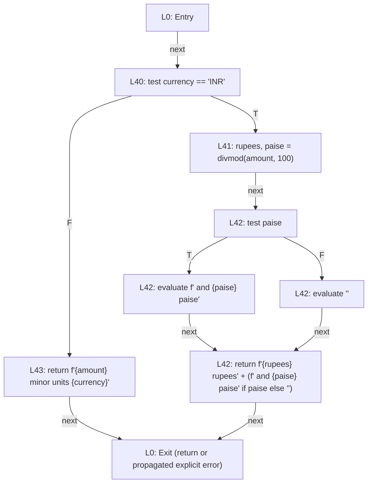

Structural independent basis (execution status as above):

- B1: n1 → n8 → n2 → n0

- B2: n1 → n8 → n7 → n6 → n4 → n3 → n0

- B3: n1 → n8 → n7 → n6 → n5 → n3 → n0

## nlu.py: rupees_to_minor

Source: [voicecart/nlu.py:118](../voicecart/nlu.py#L118), through line 132.

N=14, E=18, P=1. **E−N+2P = 18−14+2 = 6**. Predicate equivalents 5; **predicates+1 = 6**. Planar embedding has **6 regions** including the exterior.

Input/design bank: 0, 0.01, 1,000, 1,00,000.50, two thousand, malformed punctuation, negative/nonfinite and input longer than 100 characters; tests/test_nlu.py and tests/test_syllabus.py. Parser normal/handled failure paths are explicit; nested whole_number loop tests are separately documented.

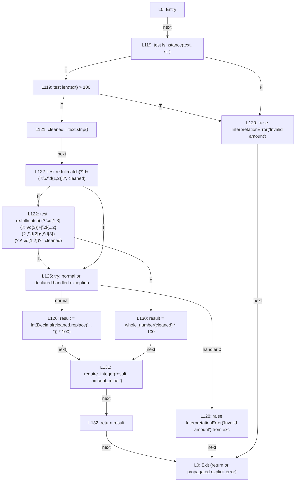

Structural independent basis (execution status as above):

- B1: n1 → n13 → n11 → n0

- B2: n1 → n13 → n12 → n10 → n9 → n6 → n5 → n3 → n2 → n0

- B3: n1 → n13 → n12 → n10 → n9 → n6 → n4 → n0

- B4: n1 → n13 → n12 → n10 → n9 → n8 → n7 → n3 → n2 → n0

- B5: n1 → n13 → n12 → n10 → n9 → n8 → n6 → n4 → n0

- B6: n1 → n13 → n12 → n11 → n0

## search.py: item_price

Source: [voicecart/search.py:41](../voicecart/search.py#L41), through line 44.

N=5, E=5, P=1. **E−N+2P = 5−5+2 = 2**. Predicate equivalents 1; **predicates+1 = 2**. Planar embedding has **2 regions** including the exterior.

Input/design bank: Qualified priced fixture versus price=None; tests/test_persistence.py and tests/test_catalogue.py.

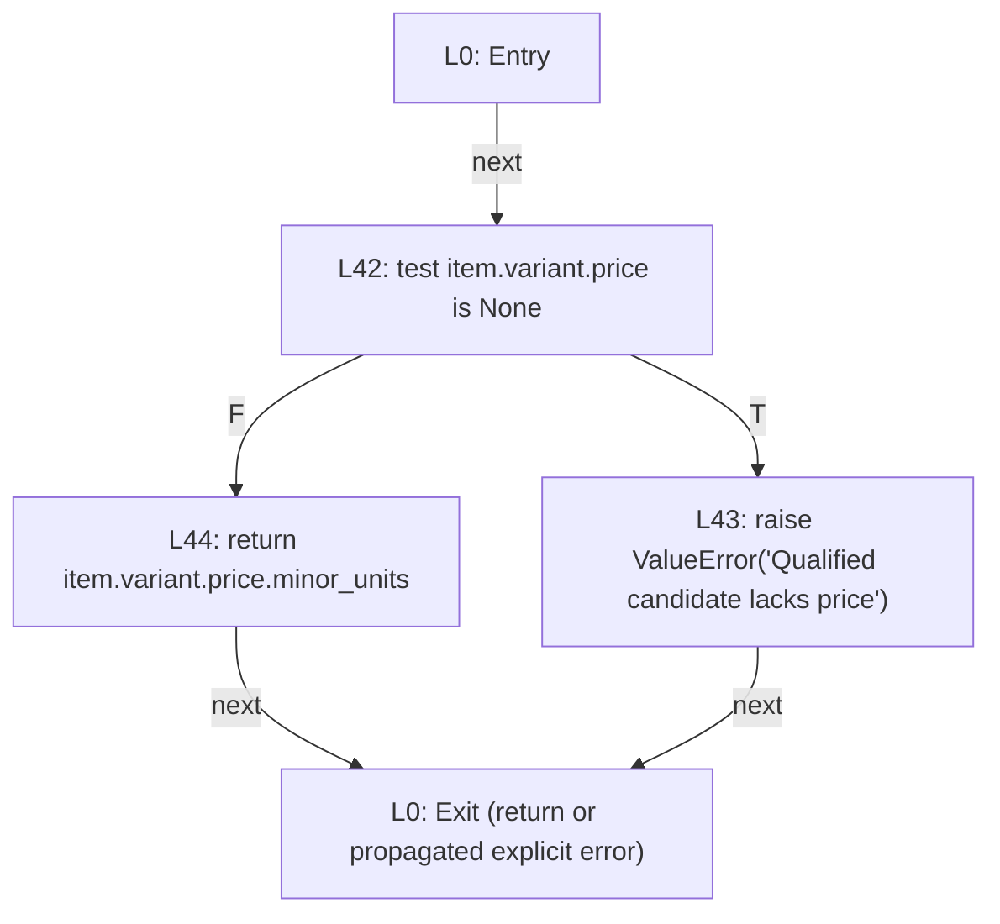

Structural independent basis (execution status as above):

- B1: n1 → n4 → n2 → n0

- B2: n1 → n4 → n3 → n0

## ranking.py: rank_qualified

Source: [voicecart/ranking.py:27](../voicecart/ranking.py#L27), through line 47.

N=17, E=22, P=1. **E−N+2P = 22−17+2 = 7**. Predicate equivalents 6; **predicates+1 = 7**. Planar embedding has **7 regions** including the exterior.

Input/design bank: Valid permutation, empty/non-string version, changed version, list output, non-string ID, duplicate/missing/injected IDs; tests/test_ranking.py.

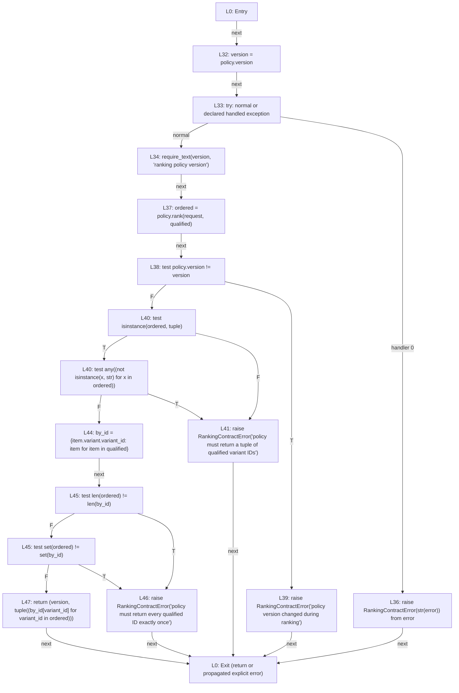

Structural independent basis (execution status as above):

- B1: n1 → n16 → n15 → n13 → n0

- B2: n1 → n16 → n15 → n14 → n12 → n11 → n9 → n8 → n6 → n5 → n4 → n2 → n0

- B3: n1 → n16 → n15 → n14 → n12 → n11 → n9 → n8 → n6 → n5 → n3 → n0

- B4: n1 → n16 → n15 → n14 → n12 → n11 → n9 → n8 → n6 → n5 → n4 → n3 → n0

- B5: n1 → n16 → n15 → n14 → n12 → n11 → n9 → n7 → n0

- B6: n1 → n16 → n15 → n14 → n12 → n11 → n9 → n8 → n7 → n0

- B7: n1 → n16 → n15 → n14 → n12 → n11 → n10 → n0

## cart.py: CartService.prepare

Source: [voicecart/cart.py:146](../voicecart/cart.py#L146), through line 185.

N=22, E=27, P=1. **E−N+2P = 27−22+2 = 7**. Predicate equivalents 6; **predicates+1 = 7**. Planar embedding has **7 regions** including the exterior.

Input/design bank: New live command, same fingerprint replay, other session/fingerprint, superseded turn, another prepared operation, ID already used by adjustment; tests/test_cart.py, tests/test_web_customer.py. Structural path coverage beyond measured branches is Not Run.

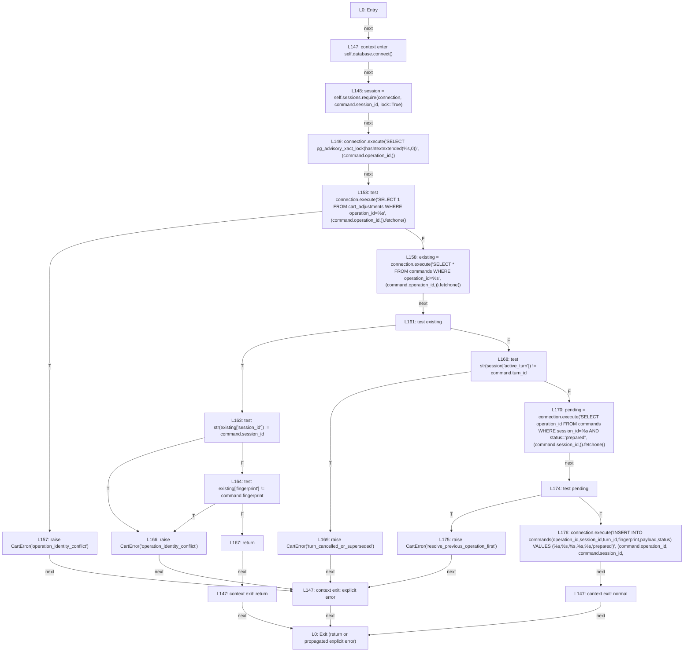

Structural independent basis (execution status as above):

- B1: n1 → n21 → n20 → n19 → n18 → n17 → n4 → n0

- B2: n1 → n21 → n20 → n19 → n18 → n16 → n15 → n10 → n8 → n7 → n5 → n2 → n0

- B3: n1 → n21 → n20 → n19 → n18 → n16 → n15 → n14 → n13 → n11 → n3 → n0

- B4: n1 → n21 → n20 → n19 → n18 → n16 → n15 → n10 → n8 → n7 → n6 → n4 → n0

- B5: n1 → n21 → n20 → n19 → n18 → n16 → n15 → n10 → n9 → n4 → n0

- B6: n1 → n21 → n20 → n19 → n18 → n16 → n15 → n14 → n12 → n4 → n0

- B7: n1 → n21 → n20 → n19 → n18 → n16 → n15 → n14 → n13 → n12 → n4 → n0

## sessions.py: SessionStore.create

Source: [voicecart/sessions.py:51](../voicecart/sessions.py#L51), through line 61.

N=10, E=10, P=1. **E−N+2P = 10−10+2 = 2**. Predicate equivalents 1; **predicates+1 = 2**. Planar embedding has **2 regions** including the exterior.

Input/design bank: ttl 0/59/60/86400/86401; tests/test_syllabus.py. DB failures separately injected in transaction tests.

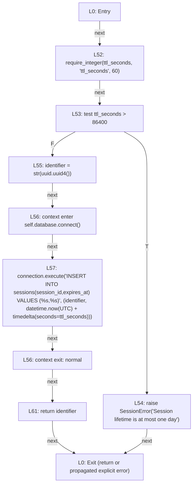

Structural independent basis (execution status as above):

- B1: n1 → n11 → n10 → n9 → n0

- B2: n1 → n11 → n10 → n8 → n7 → n6 → n3 → n2 → n0

## audio.py: _interval

Source: [voicecart/audio.py:28](../voicecart/audio.py#L28), through line 31.

N=7, E=9, P=1. **E−N+2P = 9−7+2 = 4**. Predicate equivalents 3; **predicates+1 = 4**. Planar embedding has **4 regions** including the exterior.

Input/design bank: missing/bool/nonfinite/huge integer endpoints, reversed endpoints, equal timestamps, ordered timestamps; tests/test_audio.py.

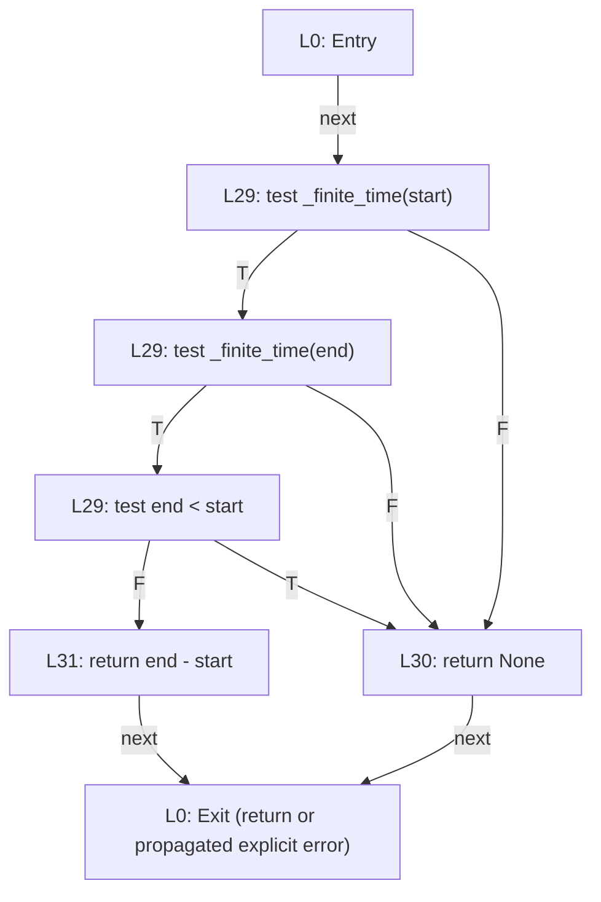

Structural independent basis (execution status as above):

- B1: n1 → n6 → n3 → n0

- B2: n1 → n6 → n5 → n4 → n2 → n0

- B3: n1 → n6 → n5 → n4 → n3 → n0

- B4: n1 → n6 → n5 → n3 → n0

## voice.py: FileArtifact.verify

Source: [voicecart/voice.py:38](../voicecart/voice.py#L38), through line 49.

N=13, E=16, P=1. **E−N+2P = 16−13+2 = 5**. Predicate equivalents 4; **predicates+1 = 5**. Planar embedding has **5 regions** including the exterior.

Input/design bank: invalid digest, missing file, empty file, one byte, exactly one read chunk, two read chunks, hash mismatch; tests/test_syllabus.py and tests/test_voice_delivery.py.

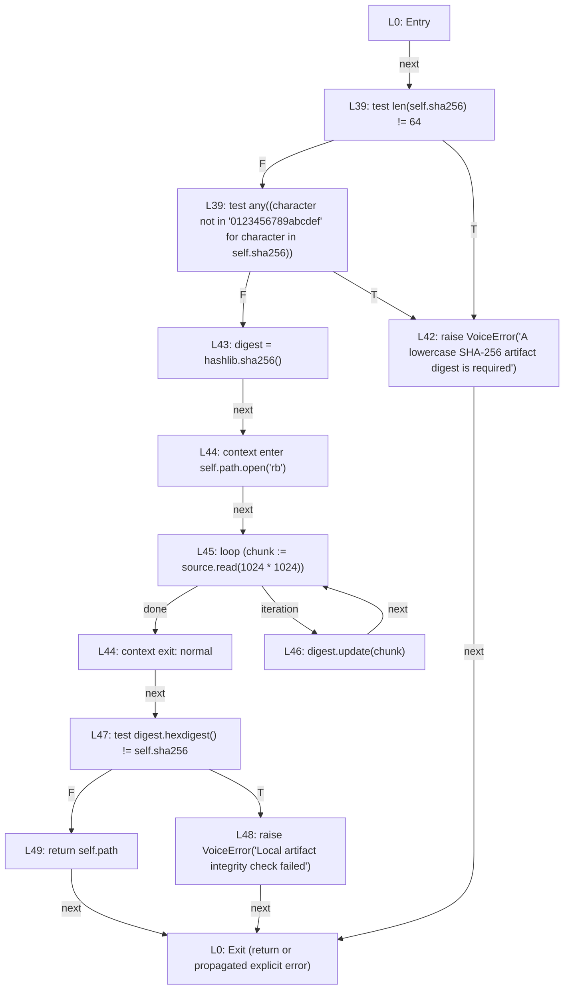

Structural independent basis (execution status as above):

- B1: n1 → n14 → n12 → n0

- B2: n1 → n14 → n13 → n11 → n10 → n8 → n5 → n4 → n2 → n0

- B3: n1 → n14 → n13 → n11 → n10 → n8 → n5 → n4 → n3 → n0

- B4: n1 → n14 → n13 → n11 → n10 → n8 → n9 → n8 → n5 → n4 → n2 → n0

- B5: n1 → n14 → n13 → n12 → n0

## catalogue.py: qualify

Source: [voicecart/catalogue.py:44](../voicecart/catalogue.py#L44), through line 99.

N=45, E=63, P=1. **E−N+2P = 63−45+2 = 20**. Predicate equivalents 19; **predicates+1 = 20**. Planar embedding has **20 regions** including the exterior.

Input/design bank: Active/inactive, each matching/mismatching/unknown attribute, available/false/unknown, stock below/equal/above quantity, missing/stale/current price, currency mismatch and LT/LTE boundary; tests/test_catalogue.py and tests/test_syllabus.py.

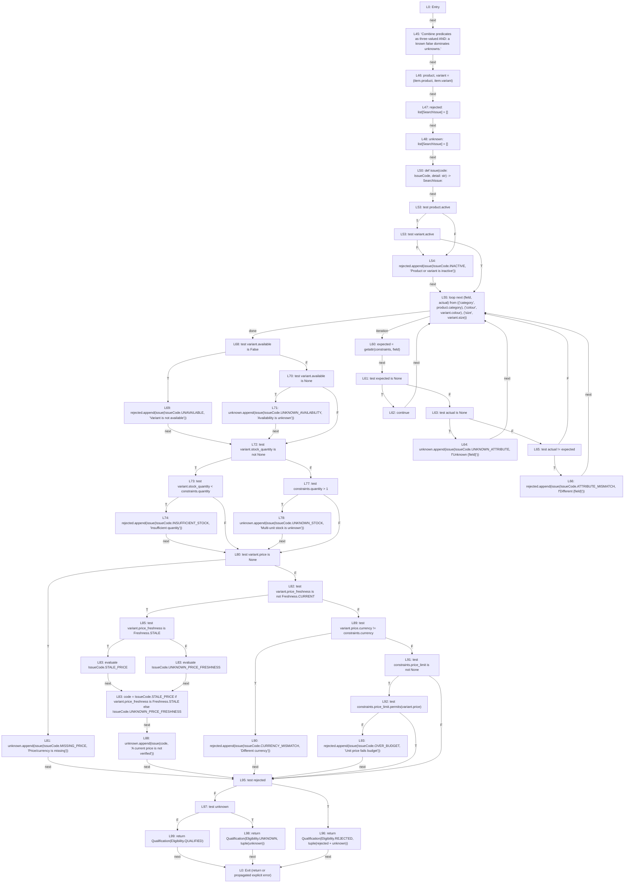

Structural independent basis (execution status as above):

- B1: n1 → n44 → n43 → n42 → n41 → n40 → n39 → n38 → n29 → n28 → n25 → n24 → n21 → n19 → n7 → n6 → n5 → n0

- B2: n1 → n44 → n43 → n42 → n41 → n40 → n39 → n38 → n29 → n28 → n25 → n24 → n21 → n19 → n7 → n6 → n4 → n2 → n0

- B3: n1 → n44 → n43 → n42 → n41 → n40 → n39 → n38 → n29 → n28 → n25 → n24 → n21 → n19 → n7 → n6 → n4 → n3 → n0

- B4: n1 → n44 → n43 → n42 → n41 → n40 → n39 → n38 → n29 → n28 → n25 → n24 → n21 → n19 → n18 → n12 → n10 → n9 → n8 → n6 → n5 → n0

- B5: n1 → n44 → n43 → n42 → n41 → n40 → n39 → n38 → n29 → n28 → n25 → n24 → n21 → n19 → n18 → n12 → n11 → n9 → n8 → n6 → n5 → n0

- B6: n1 → n44 → n43 → n42 → n41 → n40 → n39 → n38 → n29 → n28 → n25 → n24 → n21 → n19 → n18 → n17 → n13 → n6 → n5 → n0

- B7: n1 → n44 → n43 → n42 → n41 → n40 → n39 → n38 → n29 → n28 → n25 → n24 → n21 → n19 → n18 → n17 → n16 → n15 → n14 → n6 → n5 → n0

- B8: n1 → n44 → n43 → n42 → n41 → n40 → n39 → n38 → n29 → n28 → n25 → n24 → n21 → n19 → n18 → n17 → n16 → n15 → n6 → n5 → n0

- B9: n1 → n44 → n43 → n42 → n41 → n40 → n39 → n38 → n29 → n28 → n25 → n24 → n21 → n19 → n18 → n17 → n16 → n6 → n5 → n0

- B10: n1 → n44 → n43 → n42 → n41 → n40 → n39 → n38 → n29 → n28 → n25 → n24 → n21 → n20 → n19 → n7 → n6 → n5 → n0

- B11: n1 → n44 → n43 → n42 → n41 → n40 → n39 → n38 → n29 → n28 → n25 → n24 → n23 → n22 → n19 → n7 → n6 → n5 → n0

- B12: n1 → n44 → n43 → n42 → n41 → n40 → n39 → n38 → n29 → n28 → n25 → n24 → n23 → n19 → n7 → n6 → n5 → n0

- B13: n1 → n44 → n43 → n42 → n41 → n40 → n39 → n37 → n29 → n28 → n25 → n24 → n21 → n19 → n7 → n6 → n5 → n0

- B14: n1 → n44 → n43 → n42 → n41 → n40 → n39 → n37 → n29 → n28 → n27 → n26 → n24 → n21 → n19 → n7 → n6 → n5 → n0

- B15: n1 → n44 → n43 → n42 → n41 → n40 → n39 → n37 → n29 → n28 → n27 → n24 → n21 → n19 → n7 → n6 → n5 → n0

- B16: n1 → n44 → n43 → n42 → n41 → n40 → n39 → n37 → n29 → n36 → n35 → n34 → n29 → n28 → n25 → n24 → n21 → n19 → n7 → n6 → n5 → n0

- B17: n1 → n44 → n43 → n42 → n41 → n40 → n39 → n37 → n29 → n36 → n35 → n33 → n30 → n29 → n28 → n25 → n24 → n21 → n19 → n7 → n6 → n5 → n0

- B18: n1 → n44 → n43 → n42 → n41 → n40 → n39 → n37 → n29 → n36 → n35 → n33 → n32 → n31 → n29 → n28 → n25 → n24 → n21 → n19 → n7 → n6 → n5 → n0

- B19: n1 → n44 → n43 → n42 → n41 → n40 → n39 → n37 → n29 → n36 → n35 → n33 → n32 → n29 → n28 → n25 → n24 → n21 → n19 → n7 → n6 → n5 → n0

- B20: n1 → n44 → n43 → n42 → n41 → n40 → n39 → n38 → n37 → n29 → n28 → n25 → n24 → n21 → n19 → n7 → n6 → n5 → n0

## ingestion.py: exact_keys

Source: [voicecart/ingestion.py:44](../voicecart/ingestion.py#L44), through line 50.

N=6, E=8, P=1. **E−N+2P = 8−6+2 = 4**. Predicate equivalents 3; **predicates+1 = 4**. Planar embedding has **4 regions** including the exterior.

Input/design bank: Nonobject, missing required field, unsupported extra key, valid required-only, valid optional fields; tests/test_persistence.py and tests/test_dataset.py.

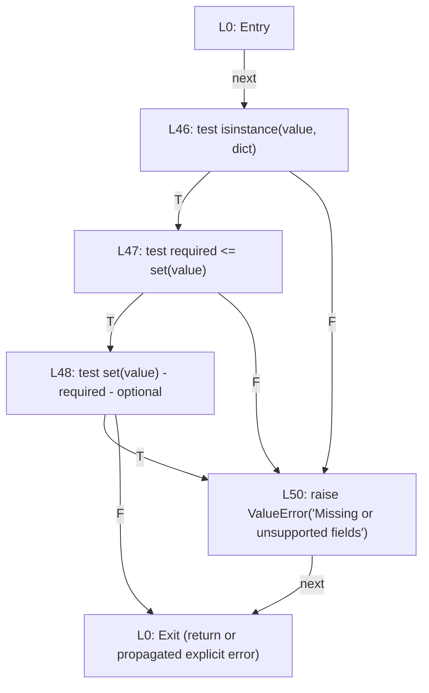

Structural independent basis (execution status as above):

- B1: n1 → n5 → n2 → n0

- B2: n1 → n5 → n4 → n3 → n2 → n0

- B3: n1 → n5 → n4 → n3 → n0

- B4: n1 → n5 → n4 → n2 → n0

## database.py: Database.check_ready

Source: [voicecart/database.py:140](../voicecart/database.py#L140), through line 170.

N=14, E=17, P=1. **E−N+2P = 17−14+2 = 5**. Predicate equivalents 4; **predicates+1 = 5**. Planar embedding has **5 regions** including the exterior.

Input/design bank: Migrated pgvector database versus missing schema/extension; real service tests and explicit startup checks. Missing-extension injection on maintained deployment is Not Run.

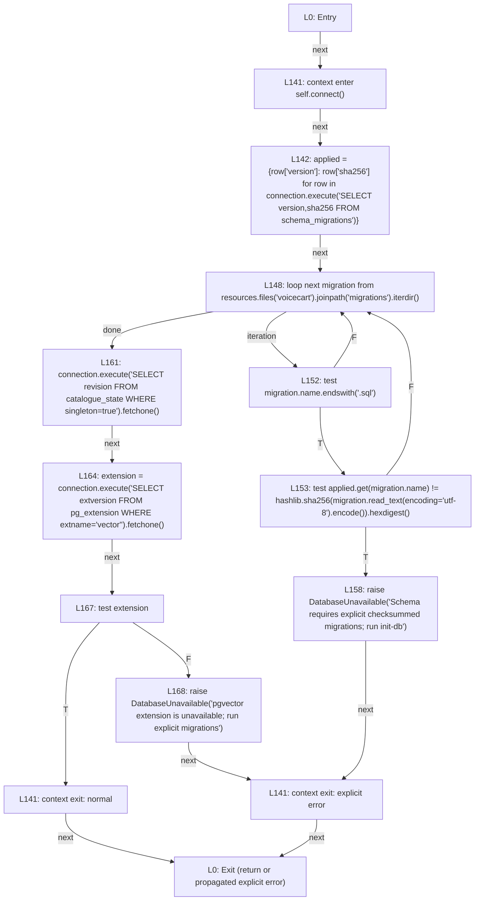

Structural independent basis (execution status as above):

- B1: n1 → n14 → n13 → n9 → n12 → n11 → n10 → n4 → n0

- B2: n1 → n14 → n13 → n9 → n8 → n7 → n6 → n2 → n0

- B3: n1 → n14 → n13 → n9 → n8 → n7 → n6 → n5 → n4 → n0

- B4: n1 → n14 → n13 → n9 → n12 → n11 → n9 → n12 → n11 → n10 → n4 → n0

- B5: n1 → n14 → n13 → n9 → n12 → n9 → n12 → n11 → n10 → n4 → n0

## merchant.py: LocalMerchantAdapter.synchronize

Source: [voicecart/merchant.py:90](../voicecart/merchant.py#L90), through line 93.

N=3, E=2, P=1. **E−N+2P = 2−3+2 = 1**. Predicate equivalents 0; **predicates+1 = 1**. Planar embedding has **1 regions** including the exterior.

Input/design bank: Valid full snapshot versus stale expected revision; tests/test_admin.py and tests/test_persistence.py; one forwarding path delegates to tested publication.

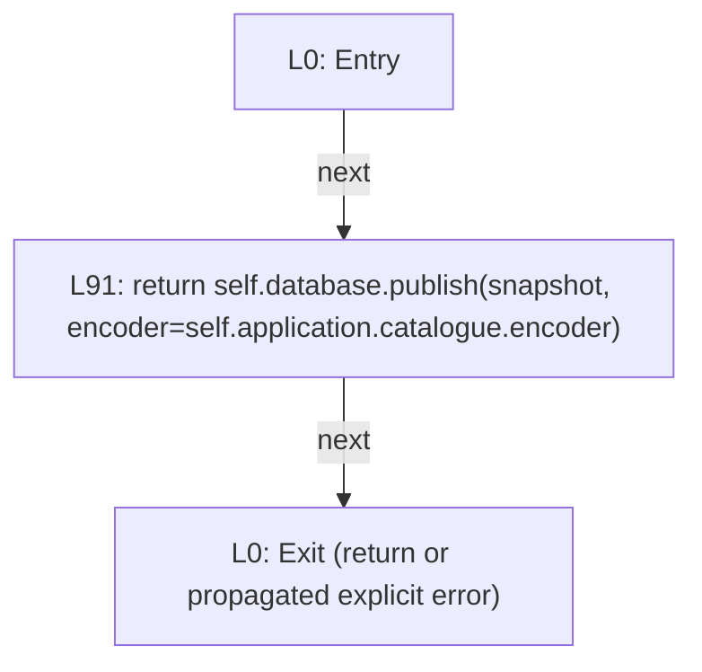

Structural independent basis (execution status as above):

- B1: n1 → n2 → n0

## http_security.py: RateLimiter.allow

Source: [voicecart/http_security.py:90](../voicecart/http_security.py#L90), through line 99.

N=15, E=17, P=1. **E−N+2P = 17−15+2 = 4**. Predicate equivalents 3; **predicates+1 = 4**. Planar embedding has **4 regions** including the exterior.

Input/design bank: Window counts 0/1/limit/limit+1, 59.999/60 seconds, 5000 distinct keys triggering storage eviction; tests/test_http_foundation.py.

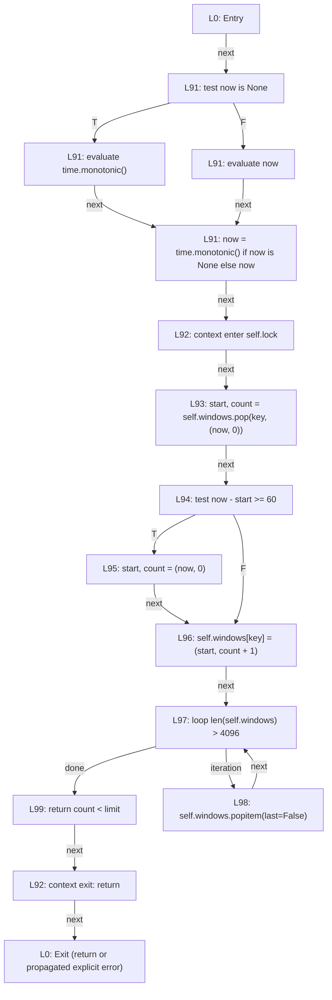

Structural independent basis (execution status as above):

- B1: n1 → n16 → n14 → n13 → n12 → n11 → n10 → n8 → n6 → n5 → n3 → n0

- B2: n1 → n16 → n14 → n13 → n12 → n11 → n10 → n8 → n6 → n7 → n6 → n5 → n3 → n0

- B3: n1 → n16 → n14 → n13 → n12 → n11 → n10 → n9 → n8 → n6 → n5 → n3 → n0

- B4: n1 → n16 → n15 → n13 → n12 → n11 → n10 → n8 → n6 → n5 → n3 → n0
