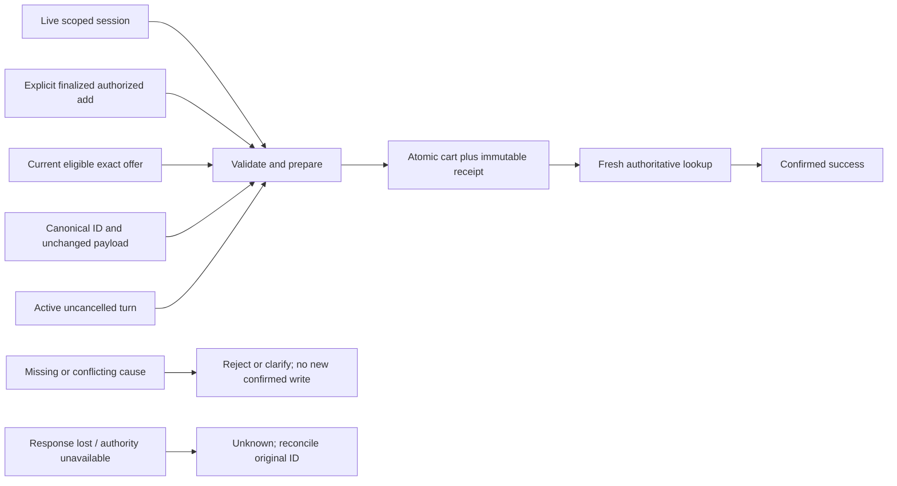
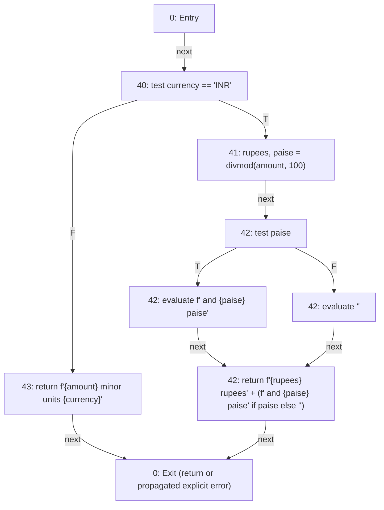
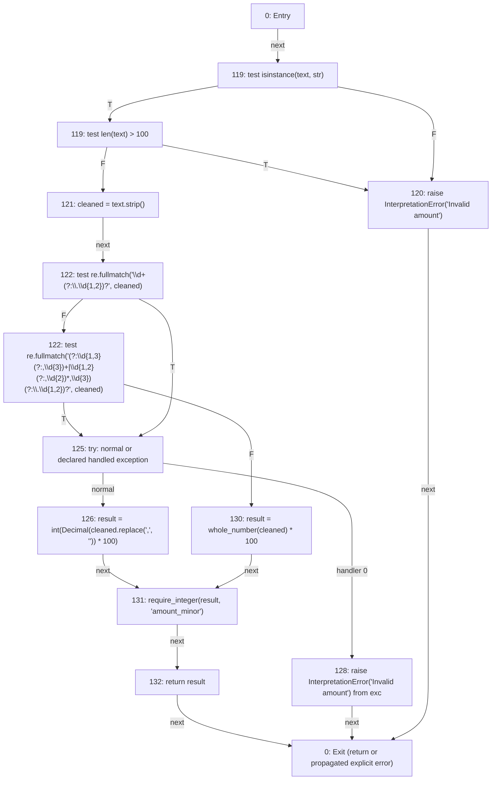

# VoiceCart professor practical pack

3 November2026. Use this as a live examination script, from repository root `voicecart`. Current reproducible observations are linked below; historical November2 evidence remains unchanged. This is a same-agent engineering demonstration, not third-party, human accessibility or production acceptance.

## Quick navigation

1. Project explanation and safe setup
2. Black-box price/eligibility/cart demonstration
3. White-box source CFG/complexity/basis/loops/coverage
4. Fifteen-step screen-sharing sequence
5. Viva answers
6. Verified commands and limitations

## 1. Opening explanation and prerequisites

Say: “VoiceCart is a local voice/text shopping prototype. A customer searches, reviews product/variant/price/freshness, explicitly selects a current offer and receives a verified local cart receipt. Historical Amazon metadata is useful for discovery but has no live inventory. The language model proposes an intent; Python independently validates quantities, price boundaries, evidence and action permission. PostgreSQL transactions, original operation IDs and immutable receipts prevent a network retry from adding twice.”

Architecture: semantic customer/admin HTML→bounded same-origin API→session/role/tenant checks→existing application/NLU validation→exact/structured/lexical+dense retrieval→qualified ranking with separate cheapest scope→transactional cart→fresh committed receipt→text/optional local Piper output. CPU Whisper returns reviewed text, not authority. PostgreSQL/pgvector shares facts, publication, sessions/cart and recovery boundary. No live merchant checkout/payment is implemented.

Black-box testing selects inputs/expected observable results from the contract without deriving tests from internal branches. White-box testing uses actual source decisions/edges/loops and measures structure. Functional testing checks required behavior; structural testing checks implementation coverage. Unit tests isolate a small contract, integration tests cross actual component boundaries, system tests exercise a supported end-to-end flow, acceptance tests evaluate agreed stakeholder criteria. A test may belong to multiple categories; a real SQL test is not hardware/user acceptance.

Prerequisites: clone into lowercase voicecart, Python3.12 verified, dedicated `.venv`, install `python -m pip install -e '.[dev,voice]'` (voice optional), Node/npm for browser/SDK, `npm ci`, `npx playwright install chromium`. Actual models must be separately provisioned with pinned artifacts; black-box/white-box practical tests do not require inference. The guarded runner creates/deletes only its owned temporary PostgreSQL/test databases. Never set normal owner DSN as a test target, import fixtures into an owner DB or use destructive volume resets. Legacy bundled PostgreSQL is disposable development tooling, not a production patch level.

A fresh run may produce different durations; report what actually happens. Nonzero exit/failure must be explained, not hidden. Read [human register](HUMAN_INVOLVEMENT_REQUIRED.md) for device/legal/deployment gates.

## 2. Black-box demonstration

### A. Equivalence partitions: money versus eligibility

Input domain: integer minor units, explicit currency, current source facts and requested price operator. One rupee=100 paise. Use a maximum 10000 minor units (INR 100.00); values9999/10000/10001 are adjacent, with no floating-point rounding.

| Input partition | Representative input | Expected observable outcome / reason |
|---|---|---|
| Valid price below limit |9999 minor |Permitted for LT and LTE, other eligibility facts held valid |
| Exactly at limit |10000 minor |LT rejects; LTE permits |
| Above limit |10001 minor |Both reject |
| Invalid negative money |-1 |Money construction raises ValueError/TypeError, not a fabricated negative-priced offer |
| Wrong numeric representation |1.5 (and bool True) |Construction rejects; bool is not accepted as integer money |
| Missing price |variant price=None |qualify returns UNKNOWN; missing is not proved over-budget or qualified |
| Wrong currency/stale facts |currency mismatch or stale price |Mismatch rejects; stale/unknown price is UNKNOWN rather than current |

Important distinction: invalid negative/float values are rejected by the type/domain boundary before a catalogue item exists. Missing price is a legitimate unknown source state evaluated by `qualify()`. Do not call all these results the same “False”.

Exact test: `tests/test_practical_contracts.py`, class `PracticalContracts`, method`test_price_equivalence_partitions_and_strict_inclusive_boundaries`. Implementation: `Money.__post_init__`, `require_integer`, `PriceLimit.permits` in `voicecart/domain.py`; `qualify` in `voicecart/catalogue.py`. Command:

```sh
python -m unittest tests.test_practical_contracts.PracticalContracts.test_price_equivalence_partitions_and_strict_inclusive_boundaries -v
```

Fresh execution: Pass in [four practical methods](evidence/20261103_S21_practical/RUN.json); complete per-method inputs/assertions are in TEST_CASES.md. Expected terminal observation is that named method ends`ok`, then`OK`; durations are measured, not promised.

### B. Boundary value analysis

Hold product active, attributes matching, current INR price, available=true and stock5 constant. Vary only one minor unit around10000.

| Actual unit price | Strict below10000 (LT) | At most10000 (LTE) |
|---|---|---|
|9999 |true |true |
|10000 |false |true |
|10001 |false |false |

This is a unit-price constraint. Existing quantity/budget parsing distinguishes per-item versus total budget and rejects ambiguous multi-unit boundaries; do not infer a total-cart budget from this table. Show the six assertions in the same practical method. Additional actual source tests: `tests.test_catalogue.StructuredSelectionTests.test_strict_and_inclusive_price_boundaries` and `test_paise_boundary_uses_integers_without_rounding`.

### C. Decision table: three-valued eligibility

Implementation `qualify(item,constraints)` evaluates known rejections and unknown facts. A known rejection dominates unrelated unknown data. This table is selective decision coverage, not all Cartesian combinations.

| Rule | Product active | Requested colour matches | Current within-bound price | Availability | Result |
|---|---|---|---|---|---|
|R1 |yes |yes |yes |verified true |QUALIFIED |
|R2 |no |yes |yes |true |REJECTED |
|R3 |yes |no |yes |true |REJECTED |
|R4 |yes |yes |no (10001) |true |REJECTED |
|R5 |yes |yes |yes |false |REJECTED |
|R6 |yes |yes |yes |unknown |UNKNOWN |
|R7 |yes |yes |missing |true |UNKNOWN |
|R8 |no |yes |missing |true |REJECTED, with unknown issues retained |

Exact test: `PracticalContracts.test_eligibility_decision_table_rejected_dominates_unknown`; implementation `voicecart/catalogue.py:qualify`. Run with the same unittest syntax. Fresh Pass in S21 practical record. Source uses clearly labelled test fixtures, not real product facts. Existing qualification contract treats explicit available=true as an assertion of at least one even if a numeric count is absent; multi-unit requests require known enough stock. The discovery UI is more conservative about enabling adds and requires a known stock count. Historical records lack affirmative availability and never become current/actionable. Do not simplify these contracts into “null always false”.

### D. Cause-effect graphing: guarded cart add

Causes are a valid live customer session(C1), explicit finalized authorized instruction(C2), current eligible exact offer(C3), canonical original operation ID/unchanged fingerprint(C4), active non-cancelled turn(C5), and authoritative committed receipt verification(C6).



AND is required for preparation; this graph describes stages, not a single Boolean that makes an unverified commit disappear. Stop after a commit cannot undo it. A repeated identical ID returns its original outcome; an altered fingerprint rejects. Unknown commit outcome is distinct from confirmed failure.

| Derived test | Input conditions / expected effect | Exact executable method |
|---|---|---|
|CE1 |All valid → one verified receipt; identical retry still one |`tests.test_cart.CartIntegrationTests.test_commit_verified_by_immutable_receipt_and_retry_exactly_once` |
|CE2 |Same ID, different payload/session → conflict, no unauthorized mutation |`tests.test_cart.CartIntegrationTests.test_same_operation_different_payload_or_session_is_conflict` |
|CE3 |Late/cancelled final → no new cart add |`tests.test_web_customer.CustomerHTTPTests.test_registered_final_cancelled_before_arrival_cannot_execute` |
|CE4 |Changed offer/partial minimum → no guessed successful add |`tests.test_cart.CartIntegrationTests.test_changed_offer_and_partial_coverage_never_commit` |
|CE5 |Commit succeeds, response lost → same receipt reconciled |`tests.test_cart.CartIntegrationTests.test_commit_reply_loss_reconciles_original_receipt` |
|CE6 |Quantity commit, verification DB outage → unknown then original-ID receipt |`tests.test_transaction_extended.ExtendedTransactionTests.test_postcommit_receipt_outage_is_unknown_then_same_id_replays` |
|CE7 |Session expires during eligibility/lock interval → no write |`tests.test_transaction_extended.ExtendedTransactionTests.test_session_expiry_during_snapshot_blocks_add_before_write` |

Open `voicecart/cart.py:CartService.prepare/_execute_once/add`, `voicecart/sessions.py:SessionStore.require/claim_final` and `voicecart/cart_management.py:set_quantity`. Use the guarded targeted runner, not a normal database:

```sh
python -m scripts.run_tests tests.test_cart.CartIntegrationTests.test_commit_verified_by_immutable_receipt_and_retry_exactly_once tests.test_cart.CartIntegrationTests.test_same_operation_different_payload_or_session_is_conflict tests.test_cart.CartIntegrationTests.test_commit_reply_loss_reconciles_original_receipt tests.test_transaction_extended.ExtendedTransactionTests.test_postcommit_receipt_outage_is_unknown_then_same_id_replays tests.test_transaction_extended.ExtendedTransactionTests.test_session_expiry_during_snapshot_blocks_add_before_write
```

Fresh CE1/2/5/6/7 execution is explicitly recorded in S21 professor cause-effect run; CE3/4 are freshly executed by the complete218-method case driver. If these commands fail during the live exam, show the actual failure and prerequisites rather than quoting a historical pass. Presenting the expected effect is not a substitute for running it.

## 3. White-box demonstration

Source and graphs below are freshly generated by `scripts/cfg_analysis.py`, not copied unverified from November2. Nodes are intraprocedural statements/decisions/normalized entry-exit, directed edges possible next control flow. OR/AND short-circuit tests are separate predicates; ternary alternatives are represented. Declared exception-handler choice contributes to the graph; arbitrary implicit external-call failures, nested callable/comprehension frames and whole callee implementations are excluded. This convention must be stated before comparing complexity numbers.

Definitions: E=directed edges; N=nodes; P=connected components (one for each selected function); D=sum(outdegree−1) for branching nodes, including documented handler choices. V(G)=E−N+2P=D+1. For these planar normalized graphs, the enumerated faces including exterior equalV. Regions are computed from an actual planar embedding, not guessed by drawing appearance. These equalities depend on the declared model; complexity is not an all-purpose minimum test count or number of feasible inputs.

### A. money_text: concrete paths

Open `voicecart/application.py`, functionmoney_text, lines 39–43. Decision1 tests INR; decision2 tests paise remainder. N=9,E=10,P=1,D=2, so10−9+2=3,2+1=3,3planar regions. The three feasible return paths have independent source assertions:

| Structural path from generated CFG | Concrete input | Exact observed expected return | Status |
|---|---|---|---|
|B1 n1→n8→n2→n0 |100,USD |`100 minor units USD` |Executed/asserted |
|B2 n1→n8→n7→n6→n4→n3→n0 |101,INR |`1 rupees and 1 paise` |Executed/asserted |
|B3 n1→n8→n7→n6→n5→n3→n0 |100,INR |`1 rupees` |Executed/asserted |

Exact test `tests.test_practical_contracts.PracticalContracts.test_money_text_three_feasible_return_paths`; run with unittest. Say that “1 rupees” is the current literal formatting contract, not a human linguistic-quality endorsement. All three logical branches are exercised, but the project-wide coverage number does not prove all graph paths across the program.



### B. rupees_to_minor: feasible versus structural paths

Open `voicecart/nlu.py`, lines 118–132. Guard checks type/length, regex alternatives choose plain/grouped numeric form, Decimal conversion or whole_number parsing, integer bounds validated before return. N=14,E=18,P=1,D=5, so18−14+2=6,5+1=6,6planar regions under the stated convention. Two guard predicates +two regex predicates +one declared handler-choice predicate=5. The whole_number callee's internal loop is not expanded into this graph.

| Structural basis | Concrete mapping | Execution/feasibility distinction |
|---|---|---|
|B1 n1→n13→n11→n0 |None → InterpretationError |Feasible and executed in practical invalid-input bank |
|B2 n1→n13→n12→n10→n9→n6→n5→n3→n2→n0 |`0.01`→1 |Plain-decimal normal path, executed |
|B3 n1→n13→n12→n10→n9→n6→n4→n0 |Decimal InvalidOperation handler after plain regex |Structural handler path; no natural bounded accepted input demonstrated; NOT RUN |
|B4 n1→n13→n12→n10→n9→n8→n7→n3→n2→n0 |`twenty one`→2100 |Word-callee normal return, executed |
|B5 n1→n13→n12→n10→n9→n8→n6→n4→n0 |Decimal InvalidOperation after grouped regex |Structural handler path; natural feasibility not established; NOT RUN |
|B6 n1→n13→n12→n11→n0 |101-character string → InterpretationError |Length guard, executed |

An additional feasible grouped-normal path n1→n13→n12→n10→n9→n8→n6→n5→n3→n2→n0 is exercised by`1,00,000.50`→10000050; it is not one of this algorithm's selected independent basis paths. Handler paths are represented defensively; do not invent an input just to claim every structural basis executed. Implicit errors inside whole_number/require_integer are outside this intraprocedural CFG convention and are tested separately. Algebraic GF2 edge independence is not logical feasibility or execution evidence.

Exact test `PracticalContracts.test_amount_parser_and_number_loop_feasible_inputs`; additional amount/grouping/negation/quantity tests in tests/test_nlu.py. Fresh Pass in S21 practical execution. The general CFG document lists all13selected source functions and source links, node/edge labels and basis paths.



### C. Loop testing: actual number-word parser

Open `voicecart/nlu.py:whole_number`, actual loop`for index, word in enumerate(words)`. Numeric strings bypass the word loop; empty words fail before entry. A zero-iteration word-loop traversal is not naturally reached with empty input because of that guard. Do not pretend it executed the loop body.

| Loop design | Concrete input | Expected / demonstrated behavior |
|---|---|---|
|Zero word iterations via numeric fast path |`0` |0; loop bypassed |
|Empty pre-loop failure |empty string |InterpretationError; no body execution |
|One iteration |`one` |1 |
|Two iterations |`twenty one` |21 |
|Typical with scale/and |`one hundred and five` |105; hundred and allowed-and branches |
|Larger input |`ninety nine lakh ninety nine thousand nine hundred ninety nine` |9999999 |
|Invalid first token |`and one` |Early failure |
|Invalid after valid prefix |`one robot` |Reject at unsupported token |
|Invalid adjacency/scale |`one one`, `one thousand thousand` |Reject, no silent dropped words |

Methods: `PracticalContracts.test_amount_parser_and_number_loop_feasible_inputs`, and `tests.test_syllabus.SyllabusPartitions.test_number_loop_zero_one_two_typical_scales_and_early_failure`. These are executable contracts; no audio/accent quality follows from typed number words. Loop iteration boundaries are not automatically every possible loop sequence.

### D. Coverage: actual fresh observation

Statement coverage counts executable statements visited; branch coverage counts observed alternatives/arcs under coverage.py's instrumentation. A statement can execute while a decision's opposite arm is never taken; thus100% statements need not imply100% branches. Neither proves correctness. Path coverage combines decisions across a whole path and can be infeasible/infinite with loops; branch coverage does not prove all combinations.

Fresh final S21 coverage is3244/3981 statements (81.49%) and933/1338 branches (69.73%),62 exclusions, in [the current JSON](evidence/20261103_S21_engineering/COVERAGE.json). The preceding S20 run independently recorded the same totals. These values are scoped to Python/CLI children, not browser JS/hardware/users. Raw missing lines/arcs remain visible. Gaps are classified in CONTINUATION_AUDIT_20261103.md: important behavior, error handling, defensive checks, legitimate business scenarios, environmental and declared exclusions. Do not call every uncovered branch unreachable.

```sh
python scripts/verify.py --postgres --package --audit --coverage --output-dir docs/evidence/NEW_UNIQUE_EXAM_RUN
python -m coverage report
python -m coverage html -d .local/exam-coverage
```

Use a NEW unique directory; refuse overwriting evidence. Open `.local/exam-coverage/index.html` after the run. `.coverage`/HTML is local/generated; committed JSON and RUN log are the durable timestamped record. Parallel/subprocess coverage includes CLI tests; nested timing spans are unrelated to branch coverage.

## 4. Fifteen-step professor presentation

Each step names the file, what to say/show, command where relevant, expected observation and likely follow-up.

1. **Open README.md**, overview/architecture. Say the opening explanation above; point out model versus deterministic authority and historical versus current data. Command`git rev-parse HEAD`. Observe exact checkout SHA. Follow-up: “Who authorizes a write?” Python/business authority and verified transaction, never model alone.
2. **Open this pack and TESTING_GUIDE.md**, reproduce/techniques. Say unit/integration/system/acceptance have different scopes. No command needed. Observe source-linked evidence, not generic textbook claims. Follow-up: “Is axe acceptance?” No, only checked automated states.
3. **Open tests/test_practical_contracts.py**, first method. Say synthetic fixtures are isolated test inputs. Run`python -m unittest tests.test_practical_contracts -v`. Observe four methodsOK, actual times. Follow-up: “Is a float a valid price?” No, Money rejects it.
4. **Point to section2A**, partition table and Money type boundary. Explain below/equal/above/invalid/unknown as distinct classes. Point to negative/bool/float assertions. Observe exceptions differ fromUNKNOWN. Follow-up: “Why not test every number?” Partition classes plus boundaries reduce cases but do not prove all inputs.
5. **Show section2B and PriceLimit.permits in domain.py**. Say under isstrict, at-mostinclusive. Run the first practical method alone. Observe9999/10000/10001 six assertions pass. Follow-up: “Does this test total budget?” No, unit-price contract only.
6. **Show section2C and catalogue.py:qualify**. Say known rejection dominates unrelated unknown. Point to rejected-before-unknown return order. Run second practical method. Observe R1–R8 expected states. Follow-up: “Does unknown prove no match?” No.
7. **Show section2D cause-effect graph and cart.py:add**. Say session/intent/offer/ID/turn are necessary but success additionally requires receipt verification. Run five guarded CE methods above. Observe fiveOK. Follow-up: “What if response is lost?” Keep original ID and reconcile.
8. **Show fresh evidence RUNs and TEST_CASES.md**, actual outcomes. Point to complete command/SHA/environment/status and retained failures. Optional command`python -m scripts.test_report --output-dir NEW_UNIQUE_DIRECTORY`. Observe current per-method results. Follow-up: “Were old files overwritten?” No, November2 JSON retained; timestamped/exclusive outputs.
9. **Open application.py:money_text and nlu.py:rupees_to_minor**, line numbers recorded above. Say these are small real implementation functions. Command`python scripts/cfg_analysis.py --output-dir NEW_UNIQUE_CFG_DIRECTORY`. Observe13verified source graphs. Follow-up: “Did the model generate a guessed graph?” AST generator follows explicit documented rules and algebra checks.
10. **Show money_text generated graph**, nodes/edges and decisions. Point toINR andpaise branches. Run its practical method. Observe three concrete returns. Follow-up: “Which basis path isUSD?” B1.
11. **Calculate both functions' complexities**, section3. Say E−N+2P, D+1 and actual planar faces. Point to9/10/3 and14/18/6 counts. Observe all three methods agree under the counting convention. Follow-up: “Why count handler choice?” This declared CFG includes it; comparison must use the same convention.
12. **Show basis mapping tables**, feasible/executed/NOT RUN columns. Run parser method. Observe guard/numeric/grouped/word cases pass. Follow-up: “All six paths executed?” No: two Decimal handler basis candidates have no natural demonstrated input; structural rank is not execution.
13. **Open whole_number loop and section3C**. Say numeric bypass and empty pre-loop failure differ from body iteration. Run syllabus loop method or full practical method. Observe valid/invalid sequences. Follow-up: “Zero-iteration loop input?” Numeric fast path bypass; empty fails before loop, no natural empty-loop traversal claimed.
14. **Open current COVERAGE.json and local HTML**, use commands in3D. Say statement/branch counts scoped to Python and current run. Point to actual missing arcs/exclusions. Observe measured report, not a target number. Follow-up: “Why not100%?” Important gaps classified; some environment/external paths need separate acceptance, coverage alone does not justify artificial tests.
15. **Open What This Demonstration Does Not Prove and human register**. Say engineering tests do not certify human usability, licensing, production or latency. No command needed. Observe explicit pending gates and actionable procedures. Follow-up: “Is the project release-ready?” Engineering demonstrable; critical real-world gates remain open.

## 5. Viva question bank

| Question | Accurate VoiceCart-grounded answer |
|---|---|
|What is black-box testing? |Contract inputs/observable outputs; price9999/10000/10001 without choosing cases from branch layout. |
|What is white-box testing? |Use real source decisions/edges/loops and measured structural coverage; money_text/rupees_to_minor are examples. |
|Equivalence partitioning? |Group inputs expected to behave alike, including valid values, invalid negative/float and legitimate unknown price. |
|Boundary value analysis? |Exercise adjacent values around a decision boundary; LT and LTE differ exactly at10000. |
|Decision table testing? |Explicit condition combinations and outcomes; qualify distinguishesQUALIFIED/REJECTED/UNKNOWN. Selective table coverage is not all combinations. |
|Cause-effect graphing? |Relate conditions to effects using logical/stage dependencies, derive session/intent/offer/ID/turn/receipt tests. |
|What is a CFG? |Directed graph of possible control transitions under a declared source modelling convention. |
|Cyclomatic complexity? |Independent structural cycle/path dimension under a connected normalized CFG; E−N+2P equalsD+1 for this representation. |
|Why do three methods agree? |They describe the same graph: algebra, branch excess and planar faces. Inconsistent conventions or nonplanarity invalidate a naive region comparison. |
|What is a basis path? |An entry-exit path adding an independent edge vector to the structural basis; it need not be feasible for real data. |
|DoesV equal tests needed? |No. It is a structural guide; infeasible paths, fault models and multiple behavioral assertions complicate test counts. |
|Path versus branch coverage? |Branches visit alternatives; paths visit combinations/sequences. Loops and infeasibility make all paths harder or impossible to enumerate. |
|Can100%statements miss a defect? |Yes: wrong assertions, untested values, opposite branches, concurrency schedules and external behavior may still be wrong. |
|Loop testing? |Bypass/pre-loop failure, one/two/typical/large iterations and invalid/early exits, e.g.number words. |
|Integration testing? |Actual SQL publication/cart/HTTP/SDK boundaries; controlled stubs are clearly separated from real services. |
|System testing? |Supported search/details/cart/retry user flow through integrated UI/API/SQL. |
|Acceptance testing? |Stakeholder/device/user criteria actually observed; scripts/protocols alone do not close it. |
|Regression testing? |Rerun existing meaningful contracts after changes, including installed-wheel tests to catch packaging/fixture path defects. |
|How prevent direct LLM mutation? |Schema constraints plus independent literal/semantic checks, finalized session/turn and deterministic business/transaction guards. |
|Why integer minor units? |Exact price boundaries and totals; floats/bools rejected rather than silently rounded. |
|What is idempotency? |The same operation identity/payload replays its original outcome; altered payload conflicts. A new ID is a new intentional mutation. |
|Why a DB transaction? |Cart and immutable receipt commit atomically; partial state cannot be confirmed. Locks/snapshots preserve concurrent eligibility/publication. |
|Uncertain transaction outcome? |UNKNOWN; retain original ID, read authoritative receipt/retry same authorized payload, never guess success or generate a replacement. |
|Do stop/repeat undo a cart? |No. Stop fences late work; committed writes remain. Repeat returns response without another mutation. |
|What proves test counts? |Only actual assertions within the recorded workload/environment;218 distinct Python methods is not218 human tasks or proof of no defects. Source+wheel are two executions. |
|What does the small NLU bank prove? |32 authored probes under pinned conditions;4B26/32 and0.6B21/32 here, not universal language understanding. Safe rejection can still be a quality failure. |
|Why no smaller-model promotion? |Faster observed model lost more canonical slots/valid requests; safety/quality and representative evaluation matter alongside latency. |
|Why exact vector scores? |Complete eligibility/minimum cannot be proved by vector topK; human relevance remains uncalibrated. |
|Current testing limits? |Physical audio/AT/users, true acoustic latency, Docker/runtime/platform, external merchant/current-source rights, independent security and legal/owner decisions remain open. |

## 6. Verified command reference

From activated repository venv; fresh guarded infrastructure requires local process/socket permission and installed dev tools. Commands were inspected and executed in the linked runs. Use a new output directory per run, or omit it for UTC timestamp defaults. `scripts/record_run.py --label NAME -- COMMAND...` creates a separate RUN/log record; static/type commands have no invented test count.

```sh
# Unit practical methods, no database or model:
python -m unittest tests.test_practical_contracts -v
# Full PostgreSQL regression; omission of --postgres can skip DB tests and is not equivalent:
python scripts/verify.py --postgres --audit
# Includes fresh installed wheel/import-location assertion/package assets:
python scripts/verify.py --postgres --package --audit --coverage
python -m coverage report
# Per-method lab records and current source CFG:
python scripts/test_report.py
python scripts/cfg_analysis.py
# Targeted safe SQL driver:
python -m scripts.run_tests tests.test_cart tests.test_transaction_extended
# Bounded synthetic search and concurrent local cart load:
python scripts/stress.py --cart-users 16
# Actual browser/SDK test server (separate terminal, disposable TEST-only data):
python scripts/browser_test_server.py
# While the test server runs on loopback8089:
npm run test:browser
npm run test:sdk
npx tsc --strict --noEmit --target es2022 --module nodenext --moduleResolution nodenext sdk/typecheck.mts
npm audit --omit=optional
```

Stop the fixture server with Ctrl+C; its own temporary database is cleaned up. Do not mix synthetic fixture server8089 with real historical preview8080 or owner hosting. Browser spec currently includes an explicit8089 scripted route; keep this documented default when running the full suite. Optional real historical-data browser validation, after the documented download/normalization and `python scripts/preview.py --port 8082`, is `node tests/manual_historical_browser.mjs http://127.0.0.1:8082 NEW_DIRECTORY`; its current actual298-record/details/admin-count assertions passed and never fabricate current offers. Optional actual inference smoke is `PYTHONPATH=. python tests/manual_voice_http.py --output-dir NEW_DIRECTORY`; requires private model assets and can fail recognition, as the fresh evidence demonstrates. Full acoustic/AT/external acceptance is NOT RUN here.

## What This Demonstration Does Not Prove

A passing suite does not prove absence of defects. Coverage does not prove correctness. Structural basis paths do not prove all feasible or possible execution paths were run. A small authored text holdout does not prove general language understanding. Structured SQL search benchmarks do not prove end-to-end voice latency. Scripted browser media and axe/focus checks do not replace actual microphone/speaker, assistive technology or blind/low-vision user evaluation. Automated security/advisory checks do not replace independent assessment of intended hosting. Synthetic test variants/sessions are not real customers/traffic/current inventory. Licensing records are not legal approval. No production readiness, universal relevance or sub1.5s audible-turnaround claim is made.
