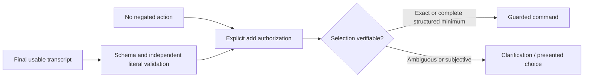
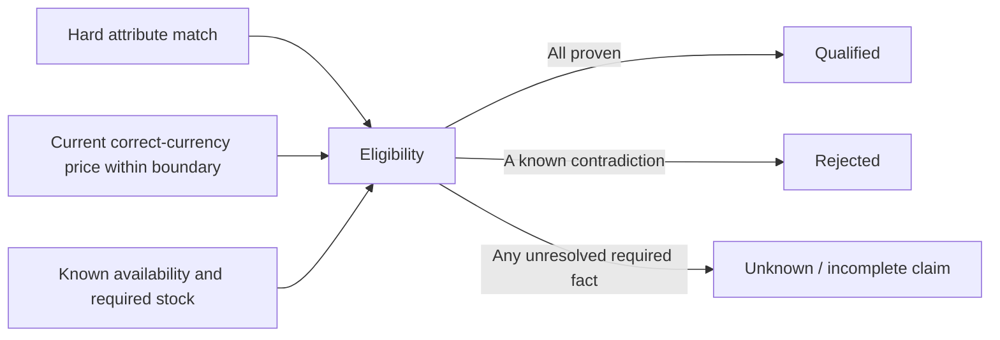
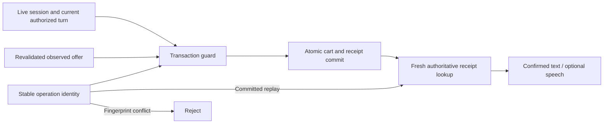
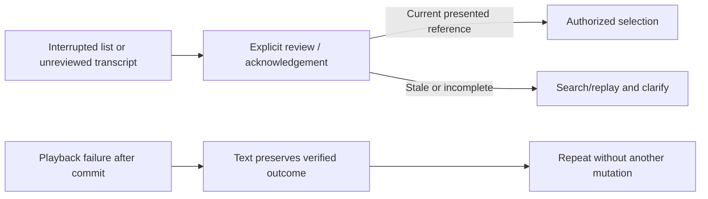
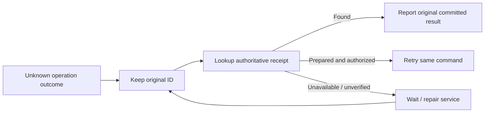

# VoiceCart testing guide and practical/viva notes

This guide maps techniques to the actual project. [TEST_CASES.md](TEST_CASES.md) contains a newly executed, source-linked record for each Python test, including the required ID/name/subsystem/designer/date/executor/preconditions/numbered actions/expected assertions/actual outcome/status/comments/postconditions/defect reference. [CFG_ANALYSIS.md](CFG_ANALYSIS.md) contains actual source line numbers, nodes/edges, three complexity calculations and structural independent paths. Historical S1–S7 counts are distinct from continued execution.

## Reproduce safely

```sh
python -m pip install -e '.[dev,voice]'
python scripts/verify.py --postgres --package --audit --coverage
PYTHONPATH=. python scripts/test_report.py
python scripts/cfg_analysis.py
PYTHONPATH=. python scripts/stress.py
npm ci
npx playwright install chromium
PYTHONPATH=. python scripts/browser_test_server.py
# In a second terminal, while the disposable fixture driver runs:
npm run test:browser
npm run test:sdk
npx tsc --strict --noEmit --module nodenext --target es2022 sdk/typecheck.mts
```

The database driver owns a temporary socket, marker and database; guards reject normal owner DBs before destructive fixture setup. Stop the browser driver with Ctrl+C to tear it down. Test credentials/products are explicitly test-only. The real historical dataset is never replaced by fabricated UI products in normal operation. Without --postgres, DB tests skip and that run is not equivalent acceptance. Each optional device/model/manual scenario must be separately executed; no missing dependency or skipped test is counted as Pass.

## Black-box design: partitions and boundaries

Equivalence partitions group inputs with the same expected behavior; boundaries distinguish adjacent inputs where behavior changes. Representative cases below are executable, not generic examples.

| Interface / actual implementation | Valid classes and representative inputs | Invalid/unknown classes | Executable evidence |
|---|---|---|---|
| Money / PriceLimit, domain.py | INR 0, 1, 2^63−1; 99/100/101 under a 100 bound | negative, max+1, bool, float, wrong currency | test_syllabus money decision table; test_domain/test_catalogue |
| NLU, nlu.py | literal category/colour/size, under vs at most, explicit exact ID/current ordinal, quantity 1–99 | negated add, fabricated evidence, omitted literal constraints, malformed/extra/duplicate JSON, unsupported currency, quantity 0/100 | test_nlu and frozen nlu_holdout.json; actual model evidence preserves safe failure |
| Query/filter/pagination, browse.py | empty browsing query, bounded text, known category/brand/currency; page offset 0, limit 1–100 | wrong types, query >1000, limit 0/101, negative offset, invalid currency, nonboolean inclusive | test_dataset/test_web_customer; browser filters/empty-state checks |
| IDs/session, sessions.py | canonical UUID, live session; TTL 60/86400 | malformed UUID, TTL 0/59/86401, other session, exactly expired or later | test_syllabus exact microsecond expiry; test_cart isolation/reference tests |
| Quantity/cart | add 1, committed replay, target quantity 2, target 0 removes | 0 add, bool/nonint, >99, unavailable/unknown/stale/insufficient stock, changed offer/ID fingerprint | test_web_customer/test_cart/test_merchant |
| Catalogue import | full valid snapshot, optional unknown facts, source hashes/provenance, duplicate-free IDs | duplicate SKU/product/variant, orphan, unknown fields, stale expiry/revision, oversized input | test_persistence/test_dataset/test_admin |
| File/import size | exactly 128 MiB admitted to validation; 128 MiB+1 rejected before read | fake large list lengths reject max count before iteration | test_syllabus mocked filesystem metadata; no huge allocation claimed |
| Authentication | valid tenant/role/capability/admin bearer | absent/wrong/tampered/expired role or token, wrong tenant, trusted-host omission | test_http_foundation/test_admin/test_merchant |
| Merchant API | pinned local adapter, observed exact offer, original operation ID, bounded refresh IDs | wrong credential/session, insecure SDK URL, missing operation ID, cross-tenant record | Python contracts, actual Node SDK integration and TS expected-error checks |

Minimum/maximum money is tested without floating-point comparisons. Browser decimal price entry uses BigInt, sends exact minor-unit strings and preserves large JSON integers. Unknown prices/attributes/variants and empty catalogues remain distinct from a verified no-match. Parser input bounds are tested as contracts, not interpreted as measured catalogue capacity.

## Decision tables converted into tests

The tables are selective decision coverage, not an assertion that every Cartesian combination has been tested.

| Rule | Conditions | Expected effect | Actual test mapping |
|---|---|---|---|
| E1 | Active, required attributes match, current currency/price, available and enough known stock | Qualified | test_catalogue full-source/eligibility and test_web_customer add |
| E2 | Required attribute mismatches or price exceeds strict/inclusive bound | Rejected | test_catalogue and test_syllabus LT/LTE rows 99/100/101 |
| E3 | Missing required attribute/price/freshness/availability or potentially matching parent has no variants | Unknown; block stronger completeness claim | test_catalogue missing/unknown/parent coverage, test_persistence |
| E4 | Same query, relevant higher-price item vs irrelevant cheap accessory | Relevance and minimum roles remain distinct; hard filters precede rank | test_ranking and exhaustive 62-product test_persistence counterexample |
| I1 | Final transcript + exact schema + literal semantics + search-only | Search, no write | test_application search/partial/duplicate-final and test_nlu |
| I2 | Explicit add + no negation + exact eligible or complete structured cheapest | Prepare guarded command | test_application and test_cart exact/cheapest |
| I3 | Negated add, dropped amount/operator/attribute, fabricated substring evidence, ambiguity | Clarify/reject; no mutation | test_nlu critical/negation/address regression; frozen model failure retained |
| I4 | Subjective discovery/ambiguous variant/unpresented or stale ordinal | Require a current presented choice | test_application unacknowledged/other-session and test_cart list tests |
| C1 | New valid session/turn/offer/ID | Atomic cart increment + immutable receipt, verify then confirm | test_cart transaction/concurrency/recovery and real HTTP add |
| C2 | Same operation and fingerprint already committed | Return original receipt, no increment | test_cart/test_web_customer and Node replay |
| C3 | Same ID with different session/payload/operation namespace | Reject identity conflict | test_cart/test_web_customer and tenant/adapter tests |
| C4 | Changed revision/price/stock, expired session or superseded turn | No new confirmed write | test_cart/session/offer/concurrency paths |
| C5 | Uncertain connection/commit | Retain same ID; authoritative lookup/retry, never blind replacement | test_cart injected uncertain-outcome recovery |
| C6 | Increase target quantity vs reduce/remove | Increase revalidates total current stock; reduce/remove commits target-state receipt | test_web_customer and CartManagement contract |
| A1 | Committed verified receipt + TTS/playback failure | Preserve truthful text/receipt; repeat does not add | test_application template-after-commit and test_voice_delivery |
| A2 | Partial/stale/cancelled ASR or interrupted output | No commerce action; stale final/list cannot reappear | test_audio, real HTTP blocking-ASR cancellation, fake-media browser race |
| M1 | Local adapter current facts/committed merchant outcome | Confirm local authoritative receipt | test_merchant and Node actual local integration |
| M2 | Historical Amazon price/unknown stock | Read-only discovery, no live global-minimum/add claim | actual DATA_SQL evidence and test_dataset/test_web_customer |
| D1 | Authenticated admin + valid expected revision/full snapshot | Atomic create/edit/deactivate/import + actual history | test_admin and admin browser workflow |
| D2 | Bad role/token/duplicate input/stale publication | Reject, previous catalogue unchanged | test_admin and two-database credential isolation |

## Cause-effect graphs

Causes are real inputs/state; effects are asserted outcomes. AND nodes require all incoming causes. Unknown facts are not silently converted to false or true.



I1–I4 above are its executable decision table. Tests cover finalized/partial, negation, malformed semantics, exact selection and ambiguity; current model quality is separately measured, not assumed from schema tests.



E1–E4 map to qualification/ranking tests. A stronger minimum needs complete sufficiently current source coverage, not a semantic shortlist.



C1–C6 map to actual PostgreSQL mutation/concurrency/replay/recovery tests, including cross-namespace and cross-tenant scope.



A1/A2 and I4 are tested through scripted device faults, real HTTP cancellation and browser review. Queued PCM does not prove audible receipt.



C2/C3/C5 and merchant contracts exercise the recovery decisions. Matching two implementations is not sufficient without an independent expected receipt/quantity oracle.

## White-box CFG and coverage

[CFG_ANALYSIS.md](CFG_ANALYSIS.md) is generated from 13 selected functions across application/NLU/search/ranking/cart/sessions/audio/voice/catalogue/ingestion/database/merchant/security. It records exact line numbers, nodes/edges/decisions, actual loops/early exits/context cleanup and declared exception handlers. Short-circuit Boolean terms are split. Nested callable/comprehension bodies are separately scoped; arbitrary implicit faults inside external libraries are not invented as explicit branches.

For each connected graph: V(G)=E−N+2P with P=1; count predicate equivalents plus one (binary decisions count once); count actual planar-embedding faces including the exterior. Edge subdivisions preserve distinct opposite/back edges while enumerating regions. The script verifies all three values agree and constructs an edge-independent basis with rank V(G). Each function lists concrete input banks and linked executable tests. Structural basis candidates can be infeasible; measured branch coverage is reported separately. **Full independent-path execution is not claimed** and unexecuted paths remain Not Run. This distinction is essential in a viva: cyclomatic complexity is a structural test-design guide, not proof of feasible/complete path coverage.

Actual statement/branch counts, covered/missing lines and missing branch arcs per file are in evidence/COVERAGE_20261102.json. `coverage report` and `coverage html` inspect them. Subprocess patching combines actual CLI child-process coverage. Native C++/ONNX/PortAudio internals and JS are outside Python coverage; browser/Node/real-model evidence is separate. No arbitrary 100% claim or omitted failing branch is used to improve the number. Remaining model/device/configuration/error branches are explicit areas for further tests.

## Loop testing

- Spoken-number parsing: zero/one/two/multiple words, scales, malformed adjacent words, early rejection and forbidden repeated scales (test_syllabus/test_nlu).
- Ingestion/embedding batches: 0/1/2/32/33 records, then second-batch failure; publication remains the original revision (test_syllabus). Parser upper-count/file-size boundaries are simulated without claiming a 250k-row load.
- Hash streaming: empty, one byte, exactly one 1 MiB chunk, one chunk plus one byte, invalid digest and mismatch (test_syllabus).
- Candidate/ranking loops: empty/one/many qualified items, duplicate/drop/injection policies, exhaustive 62-product counterexample, 2000-variant actual load (test_catalogue/test_ranking/test_persistence/stress).
- Pagination and rate-window loops: first/next/empty page, bounds and a 5000-key eviction workload (test_dataset/test_http_foundation/browser).
- Audio queues/callback loops: partial/final, stale/duplicate/cancel callbacks, repeated output, drain/abort/failure and late browser transcript (test_audio/test_voice_delivery/browser). Native device/human noise and long-session hardware soak are Not Run.

## Interface and integration strategies

Bottom-up: domain/oracle→real SQL ingestion/search→persistent sessions/cart. Top-down: application/API→scripted NLU or controlled ASR fault→assert no unsafe write, then actual local-model smoke separately. Drivers: isolated PostgreSQL runner, browser fixture server, Node SDK and stress script. Stubs: synthetic encoder/protocol/device fault adapters only inside tests; never installed as a production merchant/model. Incremental integration: each S8–S13 change preserved and reran prior suites. Regression includes package installation/SQL assets, real HTTP, customer/admin UI and tenant contracts.

Interfaces tested: frontend/backend schemas and decimal money; PostgreSQL publication/rollback/snapshots; bounded loopback inference and model digests; NLU/application literal authority; hard filters/ranking permutation; ranking/cart revalidation; PCM/ASR and TTS/drain; source/metadata/encoder publication; merchant auth/session/receipt; actual event/environment analytics. Exceptions/timeouts/uncertainty are asserted as explicit outcomes. No mock passing is counted as physical device or external merchant acceptance.

Back-to-back: deterministic in-memory/SQL qualification/minimum oracle, ranking policies on identical qualified fixtures, adapter/core receipts and actual reference/challenger model evidence. Each comparison also checks an independent expected outcome; two equal wrong answers are not correctness. Earlier three-case model smoke and the new frozen twelve-case holdout are different datasets/configurations and not pooled into an invented accuracy score.

## Stress, installation, smoke and acceptance

`stress.py` actually publishes 2000 labelled test variants, then runs 128 complete structured searches with 8 workers. LOAD_20261102.json records every workload parameter, elapsed/mean/median/exploratory P95, failures and client CPU/RSS. P99 is not estimated from this sample. This is not production capacity or full audio load. Concurrent sessions/cart/replays, repeated callbacks and injected service/commit failures are covered by source contracts; representative model contention/physical audio/long-session device soak remain separate gates.

Installation evidence: fresh wheel + actual dependency installation + imported-location assertion + complete suite and SQL assets. Native HTTP/browser health and first real supported search-to-cart flow run against a disposable real backend. Compose YAML/image digest/dependency/volume checks are static only; actual clean Docker boot/shutdown/restart/persistence and Windows/Linux/GPU acceptance are **Not Run** because this host lacks Docker. Do not claim a configuration file proves deployment.

Smoke commands: `voicecart --help`, `voicecart init-db`, `voicecart db-status`, native /health, source/wheel critical regressions, the customer/browser path and Node local merchant path. Normal initialization seeds no products. Real dataset discovery is separately exercised with 298 admitted historical rows, all non-actionable until current merchant facts exist.

Automated acceptance completed: text search/details/current-offer add/quantity/removal/replay/reload, admin guarded management/import/metrics, merchant local contract/isolation, keyboard/dialog/mobile and axe checked states. Actual fake-media/scripted-ASR browser tests prove review/cancellation UI only. **Not Run:** physical microphone/speaker/noise/echo/rupee/SKU comprehension, actual screen-reader speech and representative blind/low-vision user tasks; live external merchant integration; commercial redistribution clearance; real Docker platform; calibrated end-of-speech→meaningful audible latency. Acceptance requires their recorded results before a release claim.

Viva focus: explain why an LLM proposes intent while Python owns facts/writes; why unknown stock is not available; why LT and LTE differ at one minor unit; why a semantic top-K cannot prove a minimum; why committed receipt lookup precedes confirmation; why retries retain operation IDs; why branch coverage differs from path/human/device coverage; why a historical USD price is not a current INR offer; why physically isolated test/tenant databases prevent fixture/analytics leakage.

## Recorded continuation results

191 Python methods passed in source and 191 in a freshly installed wheel; no service skips under the full PostgreSQL driver. Combined coverage includes CLI children: 3116/3954 statements (78.81%) and 888/1320 branches (67.27%). Missing statements/arcs and 62 excluded lines remain visible in the raw report. Four Chromium customer/admin/keyboard/axe/scripted-capture tests and two actual local SDK Node tests passed; TS strict declaration checks passed. These counts exclude the seven Not Run manual/external acceptance cases and do not turn the separate 11/12 actual NLU quality result into a pass.
